# M1 Members: milestone report

Scope from the spec (§8): "F1 complete, including import, check-in and status
engine; staff home dashboard (counts only)". The first section lists what was
built for each F1 item. The "Not in M1" section lists the few items moved to
a later milestone.

## Changelog

**Database** (`supabase/migrations/20261103000000_m1_members.sql`)
- **Plans and add-ons (1.4, 1.5).** Durations in months or days, price,
  joining fee, GST, freeze allowance, PT flag and colour tag. Plans in use
  can be archived but not deleted.
- **Memberships (1.6–1.9).** Each stores a price snapshot. RPCs cover start,
  renew, freeze, unfreeze, cancel (owner) and transfer of remaining days
  (owner). They enforce:
  - no overlapping memberships;
  - the plan's freeze allowance;
  - a reason for any discount;
  - joining fee on the first membership only.
- **Status engine (1.10).**
  - Active, Expiring (configurable window), Expired, Inactive (90+ days),
    Frozen, Cancelled and Upcoming.
  - Recalculated on every change by triggers, and nightly at 00:05 IST by
    `pg_cron`.
  - Computed columns are read-only to the app.
- **Health and body (1.2, 1.3).** A PAR-Q-style questionnaire and dated
  measurements, visible only to the owner, the member and their trainer.
- **Attendance (1.12).**
  - One check-in per member per IST day.
  - Check-in by desk search, by desk scan of the member's QR, by a trainer
    for their own members, or by the member scanning a rotating daily gym
    code.
- **History timeline (1.11).** Joined, plan started or renewed, frozen or
  unfrozen, cancelled, transfers, notes, profile edits and archive/restore.
- **Search, dashboard, needs-action and import.**
  - Search indexes (trigram on name, prefix on phone) and a birthday-month
    column.
  - Dashboard counts and a "needs action today" list (renewals due, recently
    expired, birthdays, absent N days). Both are scoped by RLS, so trainers
    see only their own members.
  - CSV import with row-by-row validation and duplicate skipping.
- **Platform pieces.** A private `member-photos` storage bucket and Realtime
  on attendance, each set up when the platform supports it.

**App**
- **Members list (1.13, 1.14).**
  - Search by name, phone or ID; quick status chips; a full filter sheet
    (status, plan, trainer, batch, gender, birthday this month, joined
    between, archived); sort; filters saved on the device.
  - Pages of 30 with pull-to-refresh.
  - Long-press to multi-select: assign a trainer, or export CSV.
  - Swipe left to send a WhatsApp reminder.
- **Add member, in 3 steps (1.1, 1.2, 1.6).**
  - Photo from camera or gallery, resized to 400 px.
  - Duplicate check: the same phone blocks, a similar name warns (1.18).
  - Health details need consent; a "yes" PAR-Q answer flags the need for a
    doctor's clearance.
  - Plan, start date, add-ons and discount with a live price summary.
  - A draft is autosaved on the device.
- **Member detail.** A header with a days-left ring and these tabs:
  - Overview, with health details for those allowed to see them.
  - Membership: current and history, with freeze, unfreeze, cancel and
    transfer.
  - Payments, Workouts and Diet: "coming soon" placeholders.
  - Progress: measurements and a weight trend.
  - Attendance: a 12-week grid and "mark present".
  - Notes: the timeline.

  A sticky bar holds Collect, Renew, WhatsApp and Call. The menu has edit,
  set PIN, archive and restore, and delete forever (owner only, confirmed by
  typing the name).
- **Membership plans and add-ons catalogue.** The owner edits; other staff
  read.
- **Check-in screen.** Scanner plus search. Success shows a full-screen tick
  that auto-closes after 1.2 s; expired, frozen, cancelled or no-plan shows a
  warning. **Check-in QR** shows today's gym code on a desk tablet.
- **Member app.**
  - Digital member card with QR, status and validity (1.16).
  - Days-left ring, self check-in scanner and visits this month.
  - Progress tab with measurements and the visit grid.
- **Import (1.15).** Pick a CSV, columns are auto-matched (editable), preview
  of problem rows, import with progress, then a shareable error report.
- **Gym profile (owner).** Name, phone, address, UPI ID, GSTIN, the expiring
  window, the "absent" threshold, and the renewal-start rule.
- **Staff home dashboard.**
  - Setup steps until the owner has plans.
  - Tappable stat tiles that open the filtered member list.
  - "Needs action today" with one-tap WhatsApp (pre-filled text per reason)
    and call.
  - A live check-in feed.

**Fixes found while building**
- `ListTile`s inside sticker cards and bottom sheets triggered a debug
  assertion and hid tap ripples. Cards and sheets now carry their own
  `Material`.
- Bottom sheets opened inside a tab were covered by the floating tab bar.
  Sheets now open above it.
- All IST date logic reads one injectable clock, so tests and screenshots
  don't change from day to day.

## Tests

| Suite | Count | New in M1 |
| --- | --- | --- |
| `test/unit/` | 43 | Plan end dates match Postgres month arithmetic; days left / used fraction; CSV parsing (BOM, `;` delimiter, blank lines), header auto-mapping, Indian date parsing, row validation, in-file duplicates, error report, CSV export quoting; query serialisation |
| `test/widget/` | 37 | 13 M1 flows: list search and status chips; dashboard counts and the expiring tile filter; the full 3-step add with health consent; duplicate phone blocked; renew; freeze; trainer has no desk actions; desk check-in welcome then "already"; expired warning needs OK; CSV import end to end; owner creates a plan; member home card; notes in the timeline |
| `test/goldens/` | 56 | 22 new screenshots (light and dark): members list, member detail and its membership tab, add member steps 1 and 3, check-in and its result, plans, import, gym profile, member progress |
| `supabase/tests/rls_m1_test.sql` | 61 checks | The status engine table (every status, including the month-end edge); add with health and membership; desk can't read health or change status; trainer and owner read access; renewal starting after the current end with no joining fee; freeze limits, extension and same-day unfreeze; overlap and discount-reason guards; check-in once per day; gym code privacy; self check-in; dashboard counts; birthday needs-action; transfer and cancel; import (valid, case-insensitive plan, duplicate, missing name, unknown plan, bad phone, no partial rows); immediate and nightly recalculation |
| Edge Functions | 6 | — |

Also checked: analyzer clean, and the release web build runs in Chromium
with no console errors. Database totals: 100 checks across M0 and M1.

## Screenshots

In [`test/goldens/screens/`](../../test/goldens/screens), regenerated by the
golden tests:

| Screen | Dark | Light |
| --- | --- | --- |
| Staff home dashboard | 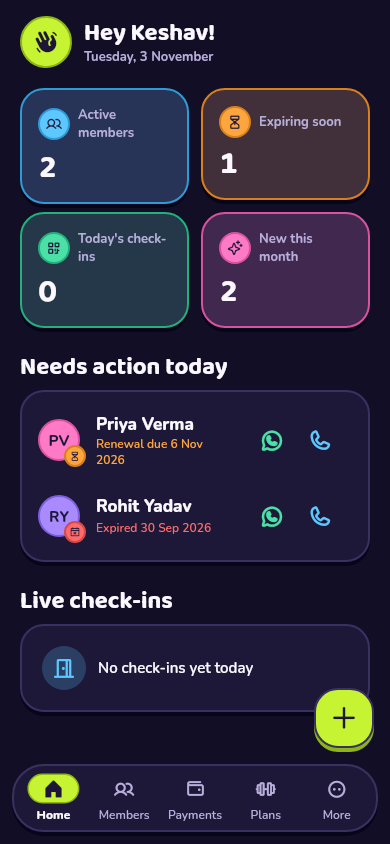 | 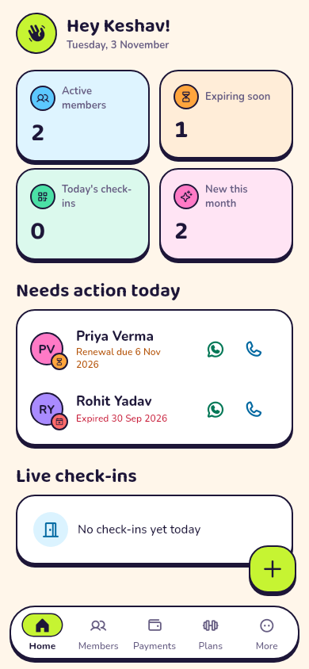 |
| Members list | 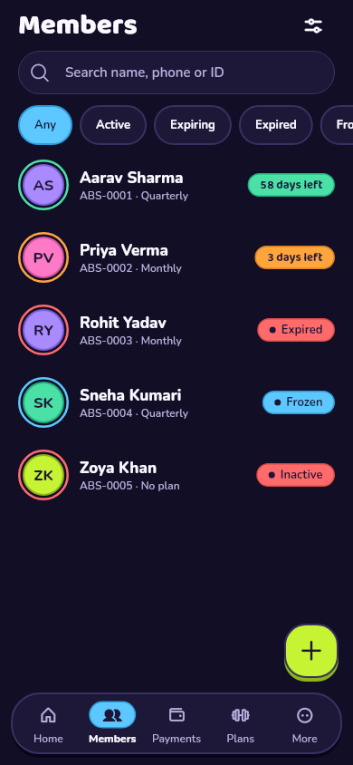 | 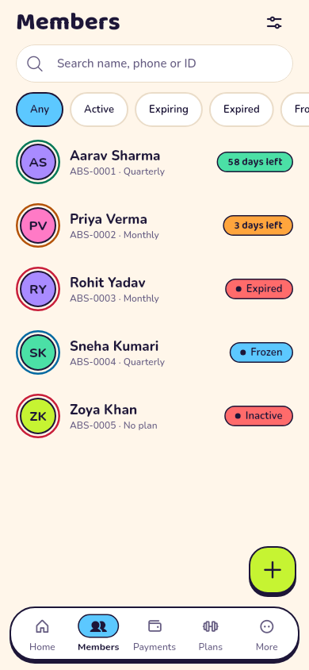 |
| Member detail | 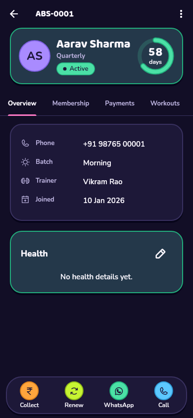 | 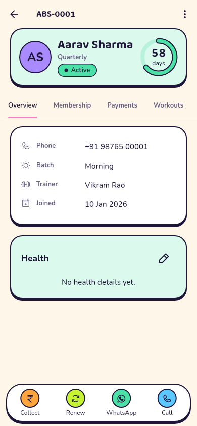 |
| Membership tab | 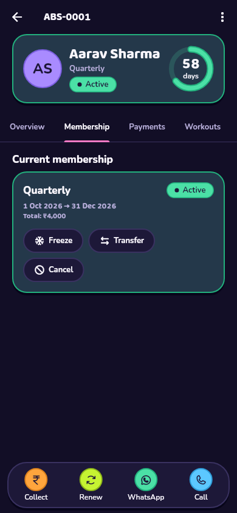 | 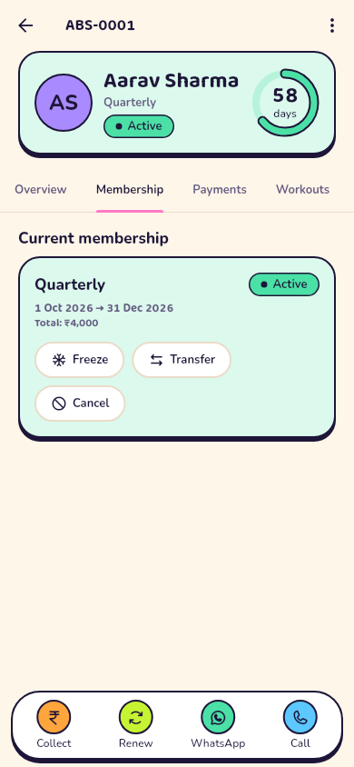 |
| Add member: basics | 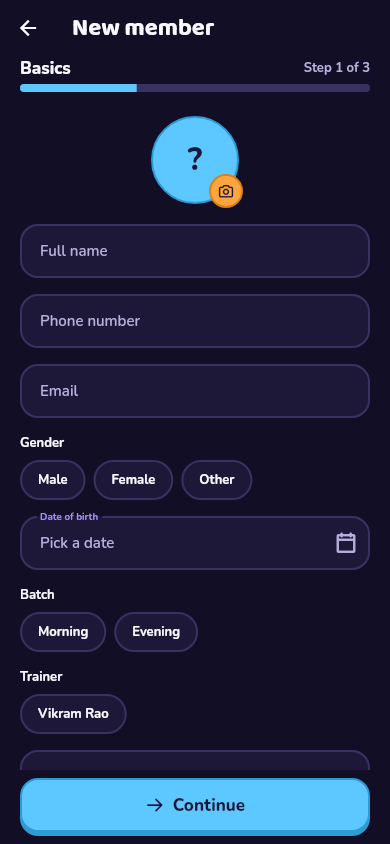 | 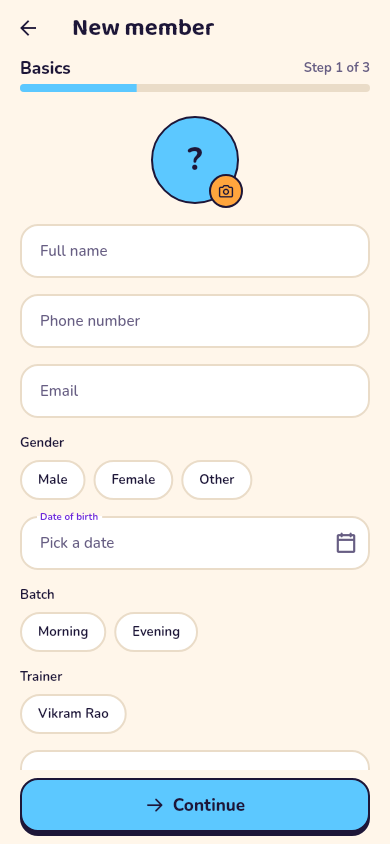 |
| Add member: membership | 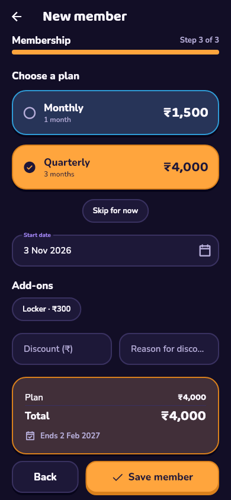 | 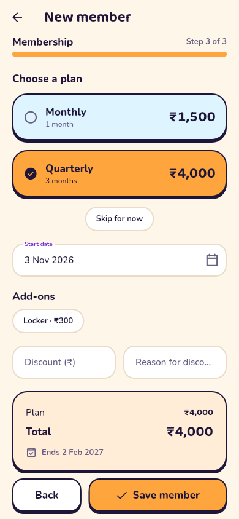 |
| Check-in | 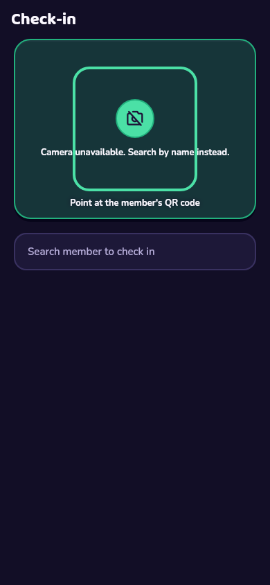 | 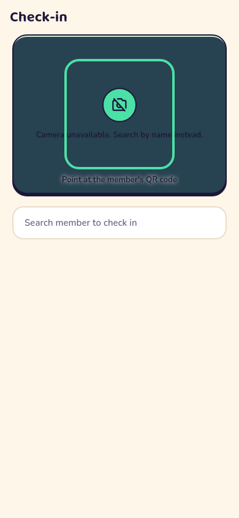 |
| Check-in welcome | 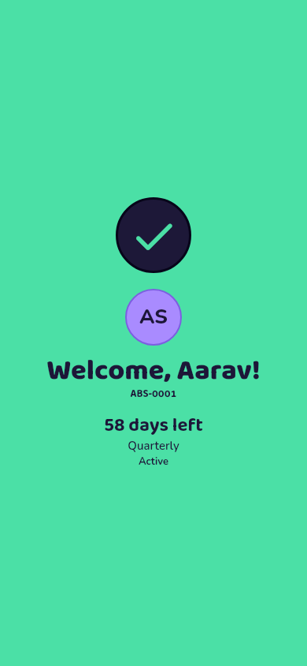 | 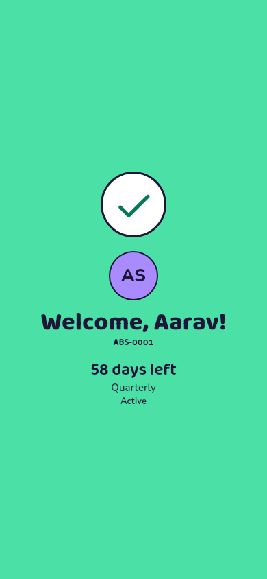 |
| Membership plans | 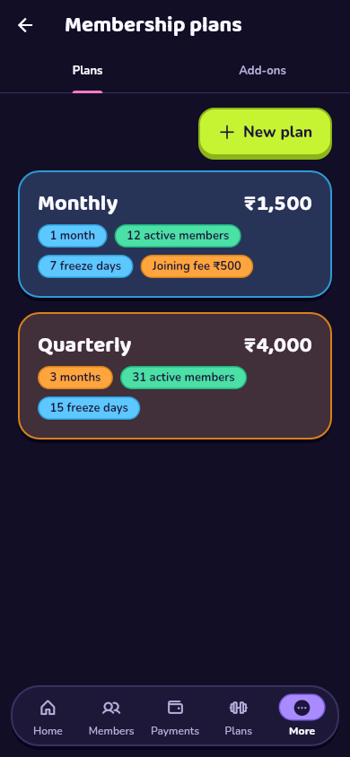 | 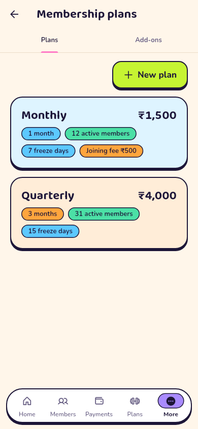 |
| Import members | 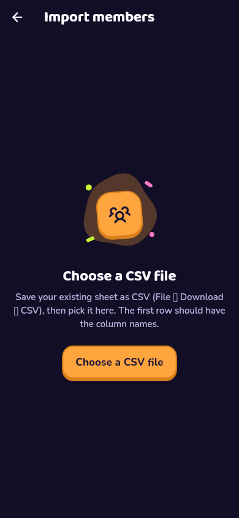 | 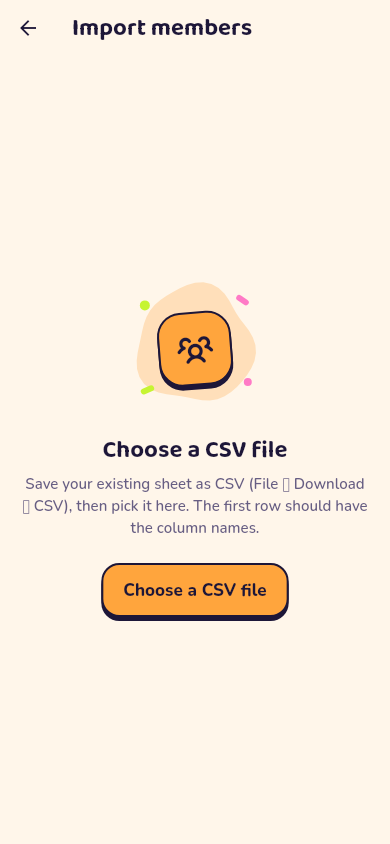 |
| Gym profile | 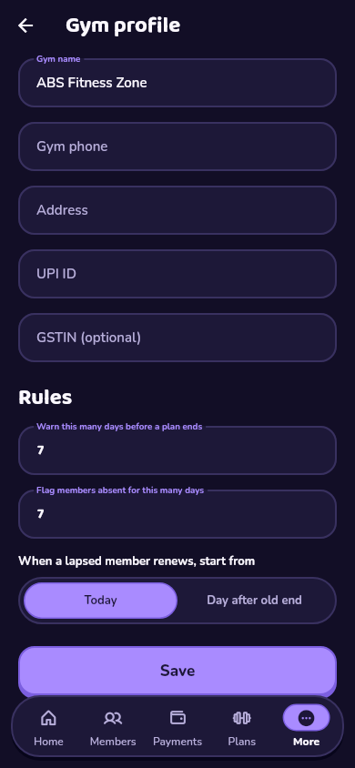 | 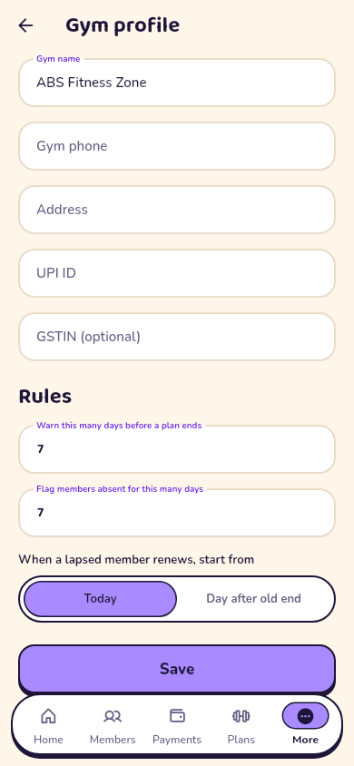 |
| Member home | 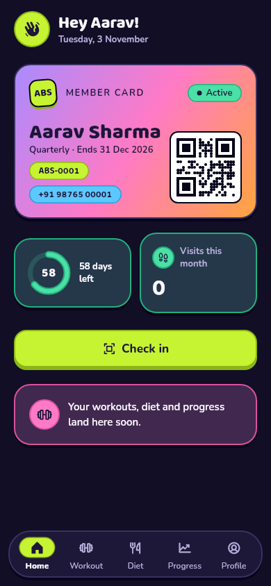 | 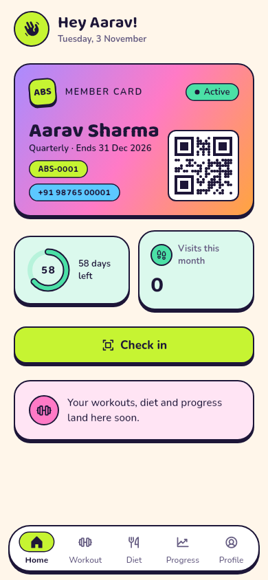 |
| Member progress | 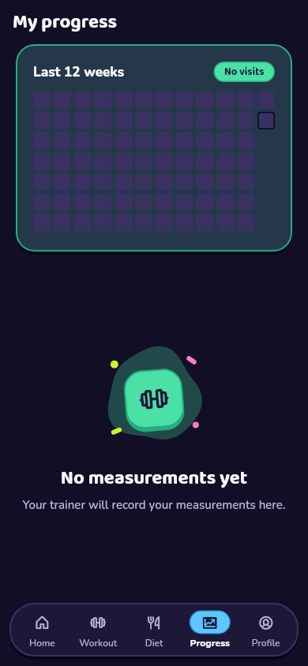 | 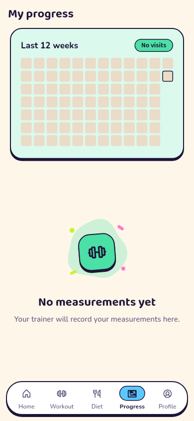 |

## Not in M1 (see DECISIONS 44)

- Document uploads (1.17) and progress photos (1.3).
- Merging duplicates (1.18).
- Optional check-out.
- The offline cache, plus biometric unlock and app lock.
- Payments: Collect and invoices arrive in M2 and will be built from each
  membership's stored price snapshot.

## Not verified here

- **An Android build:** this sandbox can't reach Google's SDK servers. The
  `main` CI job builds the APK.
- **Against a live Supabase project.** The SQL runs on Postgres 16 with a
  stubbed `auth` schema. `pg_cron`, Realtime and Storage are set up by the
  migration only when present, and need a real project to confirm.
- **Real camera scanning:** the scanner is off in tests.
