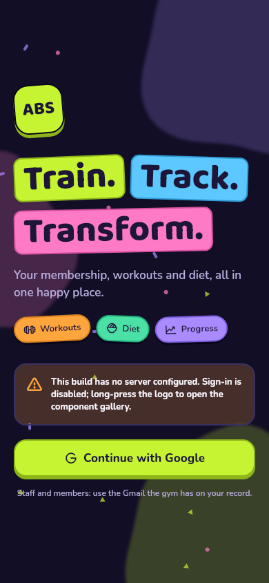
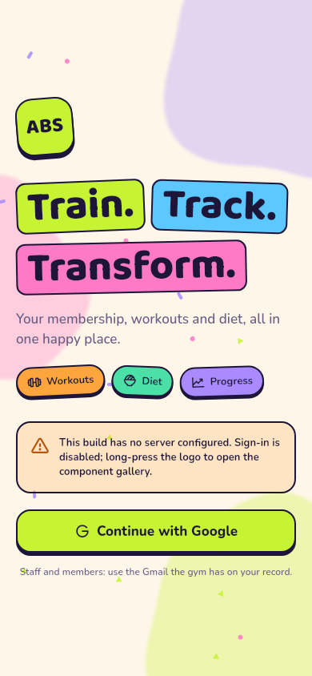
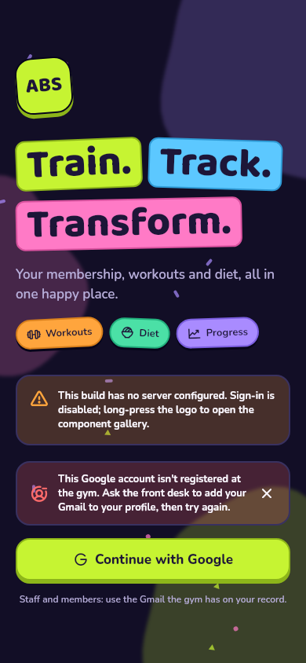
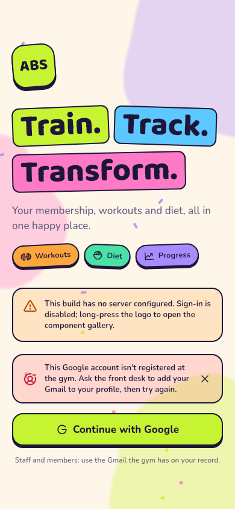
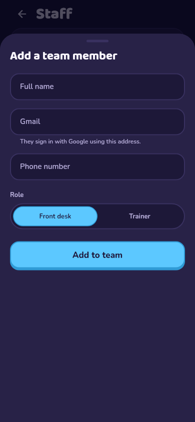
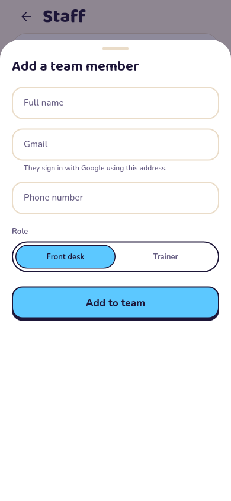
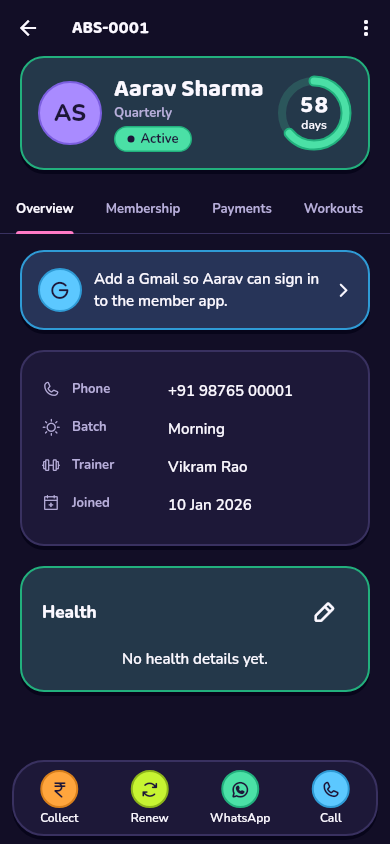
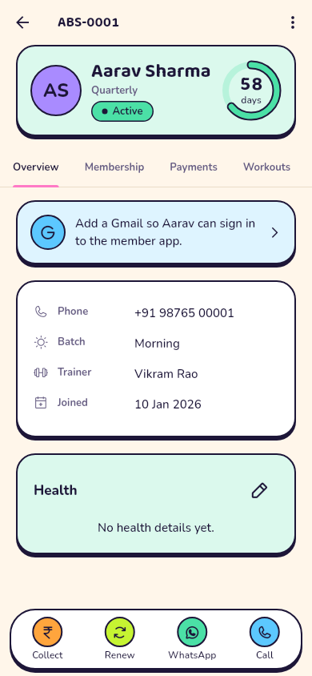

# M2.1 Google sign-in: milestone report

The owner asked for **Google as the only way to sign in**. This replaces
the spec's staff email + password and member phone + PIN logins
(DECISIONS 61–66).

## Changelog

**Database** (`supabase/migrations/20261105000000_m2_1_google_sign_in.sql`)
- **`link_my_account()`** runs on a person's first Google sign-in. It
  accepts only a verified email from a Google login, and links the login to:
  - an active staff record with that email first, otherwise
  - the one member record with that Gmail.

  It refuses, with a clear reason, an unknown Gmail, switched-off staff, a
  Gmail on two members, archived members, and non-Google or unverified
  logins.
- **`add_staff()`**: the owner adds front desk and trainers by Gmail.
  Duplicate emails, a second owner and bad emails are refused.
- **`bootstrap_owner()`** now works before or after the owner's first
  sign-in.
- **`hook_before_user_created()`**: an optional Supabase Auth hook that
  refuses non-Google sign-ups and Gmails the gym doesn't know.
- **Removed:** the PIN table and lockout, the PIN and password functions,
  and the forced-password flag.

**Edge Functions**
- Removed `member-login`, `set-member-pin` and `invite-staff`, and the
  validators only they used.

**App**
- **Welcome screen:** one **Continue with Google** button. A note says to
  use the Gmail the gym has on file.
- **Refused accounts:** if the gym refuses a Google account, the welcome
  screen says why: not registered, access switched off, or a Gmail shared
  by two members. The note can be closed.
- **Account picker:** the Google account picker always shows, because desk
  phones are shared. On phones the app opens Google in the browser and
  comes back through `com.absfitnesszone.app://login-callback`.
- **Removed screens:** staff login, member PIN login, the email link, set
  password, and Member PIN (in More and on a member's page).
- **Staff → Add staff:** asks for the person's Gmail and role, then shows
  the Gmail they will sign in with. There is no temporary password.
- **Members:** the email field is now **Gmail**, with "Used to sign in to
  the member app". A member page without a Gmail shows a card (desk only)
  that opens Edit.
- **Router:** the old `/login/*` and `/set-password` links now go to the
  welcome screen.

## Tests

| Suite | Count | Changes |
| --- | --- | --- |
| `test/unit/` | 57 | The sign-in failure mapping (`link_my_account` codes, rate limits, refused sign-ups) and messages; router: old login links go to welcome; owner-only expenses and gym profile; trainers can't open payment pages. Removed the PIN and password tests. |
| `test/widget/` | 51 | Welcome offers only Google; staff and member sign in with Google; an unregistered account is told to ask the desk; switched-off staff and shared Gmails get their own message; the owner adds staff by Gmail. Removed the PIN, password and login-form flows. |
| `test/goldens/` | 76 | New: the welcome screen with a refused account, and the Add staff sheet (light and dark). Removed: staff login, member login, set password and Member PIN. Updated: welcome, More, Staff, member detail (Gmail card) and add member (Gmail field). |
| `supabase/tests/rls_m2_1_test.sql` | 37 checks | The old pieces are gone. Owner setup before and after sign-in, including refusing a second owner. Adding staff (case, duplicates, second owner, bad email; desk refused). Staff and member linking (case-insensitive, right record, own data only). Refusals: shared Gmail, archived member, unknown account, switched-off staff, email/password login, unverified email, anon. A new Google login replaces an older one. The sign-up hook allows and refuses. |
| `supabase/tests/rls_m0_test.sql` | 27 checks | The PIN checks were removed with the feature. |
| Edge Functions | 7 | Razorpay (6) and the UUID check. |

Database totals: 207 checks across M0–M2.1. The analyzer is clean.

## Screenshots

| Screen | Dark | Light |
| --- | --- | --- |
| Welcome |  |  |
| Account not registered |  |  |
| Add staff by Gmail |  |  |
| Member without a Gmail |  |  |

## Setup needed (see README, Supabase setup steps 3–8)

1. Create a Google OAuth client (Web application) with the redirect URI
   `https://YOUR_PROJECT_REF.supabase.co/auth/v1/callback`.
2. Turn on Google in Supabase Auth, and turn off the Email provider.
3. Add `com.absfitnesszone.app://login-callback` to Redirect URLs.
4. Optional: add the Before User Created hook.
5. Run `supabase db push`. On an existing project, delete the three retired
   functions.

## Not verified here

- **A real Google sign-in.** This needs the Google OAuth client and a
  Supabase project. The linking rules run on Postgres 16 with a stubbed
  `auth.users` that has the same columns Supabase uses (`email`,
  `email_confirmed_at`, `raw_app_meta_data`).
- **The sign-up hook in Supabase Auth.** The function is tested directly
  with the documented event shape.
- **The browser round trip on Android and iOS.** The deep link was already
  registered for the old email link and is unchanged.
