# M2 Payments: milestone report

Scope from the spec (§8): "F2 complete, receipts, UPI QR, day close, dues
engine". The changelog lists what was built for each F2 item. The "Not in
M2" section lists what moved to a later milestone (see DECISIONS 60).

## Changelog

**Database** (`supabase/migrations/20261104000000_m2_payments.sql`)
- **Invoices (2.1).**
  - Raised automatically when a membership starts or renews. Lines are the
    plan, the joining fee (first membership only) and add-ons, with any
    discount spread over the lines.
  - Each invoice keeps a snapshot of the member's name, code and phone, so
    it survives the member being deleted.
  - Numbers run per financial year: `ABS/26-27/0001`, and receipts
    `RCPT/26-27/0001`. They are never reused.
  - GST is off until the owner turns it on. Prices include GST by default,
    or GST can be added on top. It is split into CGST and SGST.
- **Collecting (2.2, 2.4).**
  - Cash, UPI, card and bank transfer. UPI and bank need a reference (UTR).
  - Part payments are allowed. Paying more than the balance saves the
    extra as member credit, which the desk can apply to a later invoice.
- **Instalments (2.6):** up to 4 dated parts that add up to the total.
  Payments fill them in order, and the next unpaid part sets the due date.
- **Member self-pay (2.3, 2.5).** A UPI link and QR (free mode). The member
  taps "I've paid" and enters the UTR; the claim waits for the desk to
  approve or reject it (rejecting needs a reason). A UTR can be used once.
- **Razorpay (optional, 2.3).** Payment links through an Edge Function. The
  webhook checks the signature and is safe to retry: the same event is
  never counted twice. Off unless the owner switches it on.
- **Voids and refunds (2.11).** Owner only, a reason is always required,
  nothing is deleted, and every change is audited. Voiding a payment also
  reverses any credit it created. An invoice can be voided only when
  nothing is paid on it.
- **Dues engine (2.8, 2.9).**
  - Overdue days and each member's dues update on every payment, and
    nightly at 00:10 IST.
  - Reminders follow the schedule: 3 days before, on the day, and 3 and 7
    days after.
  - Overdue fees appear in "Needs action today", and check-in shows a
    member's pending fees.
- **Day close (2.13).** Totals by mode, the cash counted and the
  difference. Closing locks that staff member's collecting for the day
  until the owner reopens it.
- **Expenses (2.12)** are owner only.
- **Report hooks (2.14).** `collections_summary` returns collected, by mode,
  by day, invoiced, outstanding, refunds and expenses. `dues_summary`
  returns the overdue and due totals and the number of claims waiting.
- **Billing profile.** A signed-in-only `billing_profile` adds the GSTIN
  and the payment switches to the public gym details, for receipts and pay
  screens. Secrets are never included.
- **Safety nets.** A guard trigger blocks direct writes to money tables. A
  deferred check makes sure an invoice's paid amount always equals its
  confirmed payments. Row Level Security covers every table: trainers see
  no money, and members see only their own.

**App**
- **Payments tab (desk and owner).**
  - A "Collected today" hero (the whole gym for the owner, your own for the
    desk) with mode stickers and a Close day button.
  - A "Fee reminders today" card. Each reminder sends a pre-filled
    WhatsApp message with the UPI link.
  - Tabs: Due, Overdue, Paid and To verify (with Approve / Reject), with
    counts.
  - Search, pages of 30, and a Collect button on each row.
- **Collect sheet.**
  - Find the member by search, or pick straight from the overdue list.
  - Choose the invoice. If there is only one open invoice it is chosen for
    you.
  - Type the amount on a big keypad, with quick chips for the full amount,
    the next instalment or member credit. A live hint says what will still
    be due, or how much credit will be saved.
  - Choose the mode, and enter the UTR for UPI or bank.
  - Confirm: the button turns into a tick, then the receipt card flips in
    with confetti. Share it, print it or send it on WhatsApp.
- **Invoice detail.**
  - Items, discount, GST lines, total, paid and balance.
  - Split into instalments, with a check that the parts add up.
  - The payment timeline, with a receipt for each payment.
  - A UPI QR sheet, a "Send link" WhatsApp message, the Razorpay link (when
    on), and Apply credit.
  - For the owner: void a payment, refund, or void the invoice.
- **PDF receipt (2.7)** made on the phone: A5, gym details and GSTIN,
  items, GST split, mode, UTR and balance. About 13 KB, built in about
  0.1 s.
- **Other screens.**
  - Day close, with the live difference ("₹100 short"). The owner sees
    recent closes and can reopen one.
  - Payment history, with search and filters for dates and mode.
  - Expenses, by month, with categories (owner only).
- **Staff home.**
  - For the owner: a revenue hero (Today / This week / This month)
    counting up, with the outstanding total and a 30-day sparkline.
  - For the desk: "Overdue fees" (₹ and number of invoices) and "Payments
    to verify" tiles.
  - Overdue rows in "Needs action today", each with a WhatsApp reminder.
- **Member detail.**
  - A Payments tab with invoices, payments and credit, and a dues sticker
    in the header.
  - The Collect button opens the sheet for that member.
  - After a renewal, the collect sheet opens straight away.
  - Trainers see neither the tab nor the Collect button.
- **Members list:** swipe right on a member to collect.
- **Add member:** with a plan chosen, the app lands on the new member with
  the collect sheet open.
- **Member app.**
  - A "Fees due" card on home.
  - My payments: invoices with "Pay now", claims waiting for the desk, and
    receipts to share.
  - The Pay screen: open the UPI app, or scan the QR from another phone,
    then "I've paid" with the UTR.
- **Gym profile:** switches for Charge GST (needs a GSTIN), Prices include
  GST, and Razorpay payment links.
- **More:** Day close and Payment history (desk), Expenses (owner).

**Fixes found while building**
- Calendar dates in payment data are read as plain dates, so they don't
  shift with the phone's time zone.
- The Expenses add button sat under the floating tab bar on phones.
- Trainers could see the Collect button on a member's page. It is now for
  the desk and owner only.

## Tests

| Suite | Count | New in M2 |
| --- | --- | --- |
| `test/unit/` | 59 | UPI link format, encoding and validation; overdue days and next instalment; JSON parsing including the `void` status; billing profile flags; Monday-start week and month periods in IST; keypad money input and Indian grouping; the fake part payment → credit flow and day-close lock; PDF receipt under 150 KB and under 1 s |
| `test/widget/` | 51 | 14 M2 flows: desk part payment with receipt; UPI needs a UTR and overpayment becomes credit; approve a claim (reject needs a reason); day close difference, lock, then collecting is blocked; owner revenue hero and overdue in needs-action; trainers see no money; instalments must add up; owner voids an invoice; member pays and sends "I've paid"; owner adds an expense; desk can't open expenses and history filters by mode; member Payments tab; trainer has no Collect; check-in shows pending fees |
| `test/goldens/` | 80 | 24 new screenshots (light and dark): Payments, Overdue tab, collect sheet, receipt celebration, invoice detail, day close, expenses, payment history, member Payments tab, member home with dues, My payments, Pay screen |
| `supabase/tests/rls_m2_test.sql` | 82 checks | Financial-year numbers, GST maths, auto invoices (renewals skip the joining fee), part payment, overpayment to credit, direct writes blocked, the paid-amount check, trainer and member access, claim → verify, credit use, instalments, the reminder schedule, summaries, expenses, day close lock and reopen, void and refund, void invoice, Razorpay retries counted once, dues at check-in, member delete keeps invoices, the billing profile hides secrets |
| Edge Functions | 12 | Razorpay signature checks, parsing the paid event, the payment link body |

Also checked: no analyzer warnings or hints, and the release web build runs
in Chromium with no console errors. Database totals: 182 checks across M0–M2.

## Screenshots

In [`test/goldens/screens/`](../../test/goldens/screens), regenerated by the
golden tests:

| Screen | Dark | Light |
| --- | --- | --- |
| Staff home (revenue) | 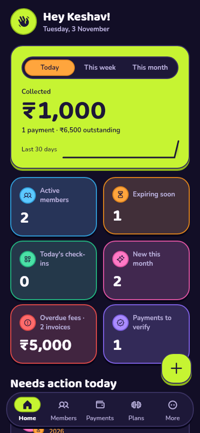 | 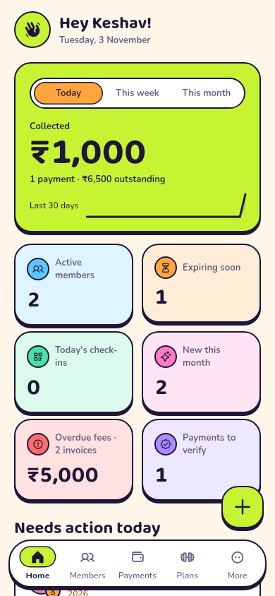 |
| Payments | 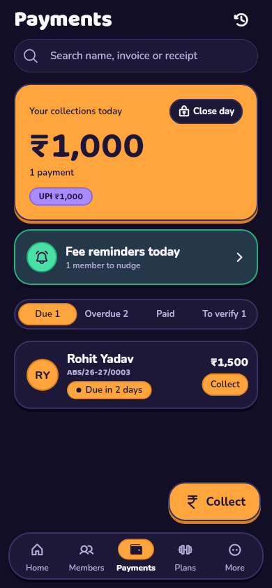 | 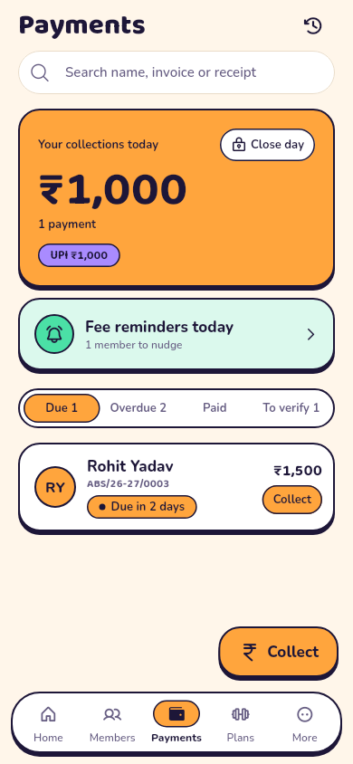 |
| Payments: overdue | 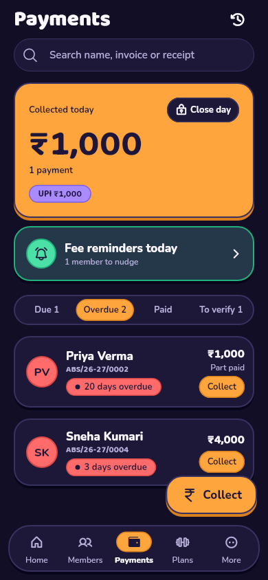 | 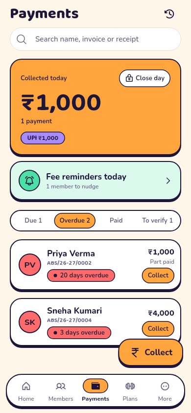 |
| Collect sheet | 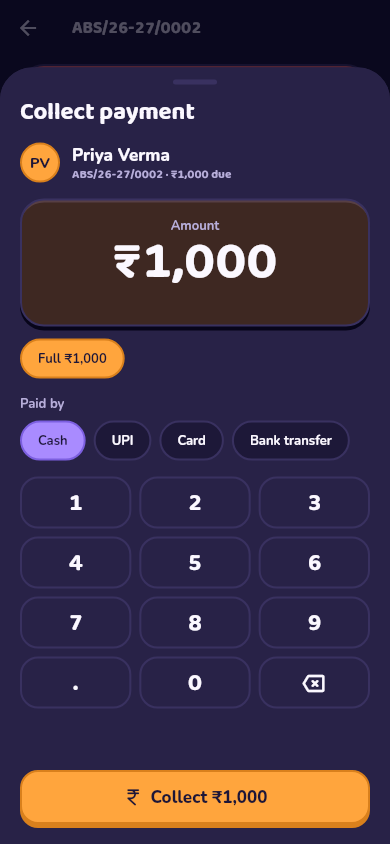 | 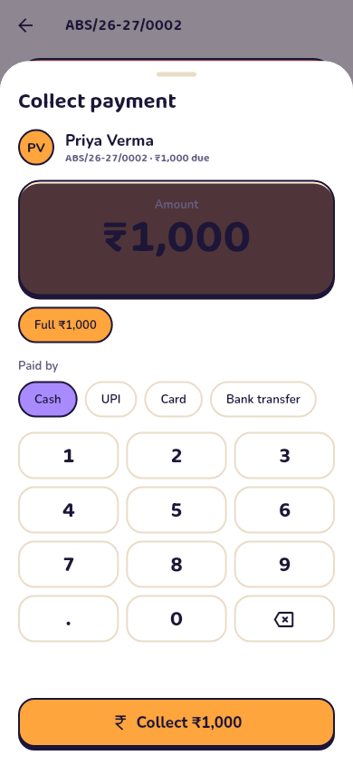 |
| Payment received | 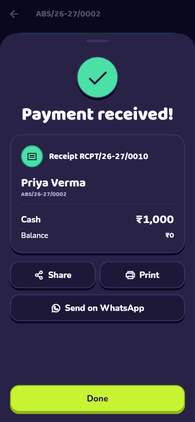 | 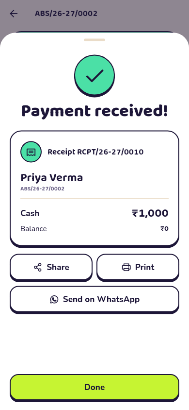 |
| Invoice detail | 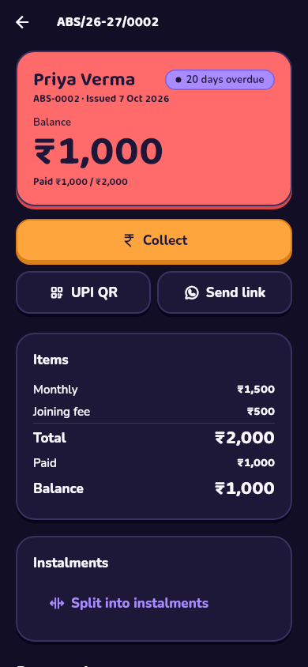 | 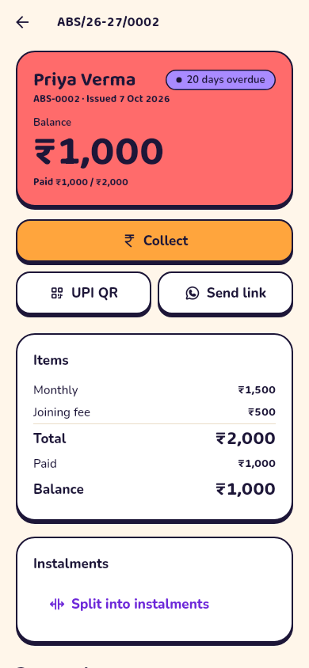 |
| Day close | 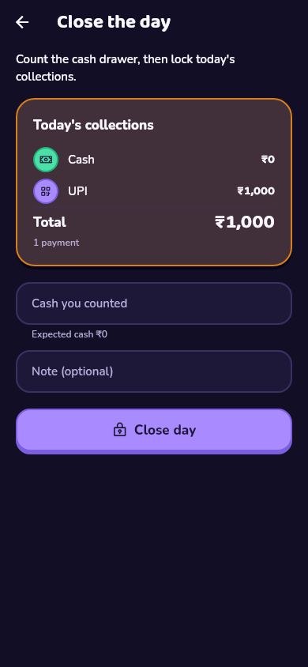 | 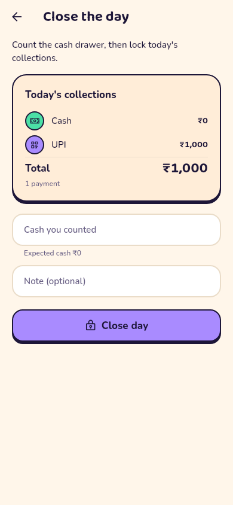 |
| Expenses | 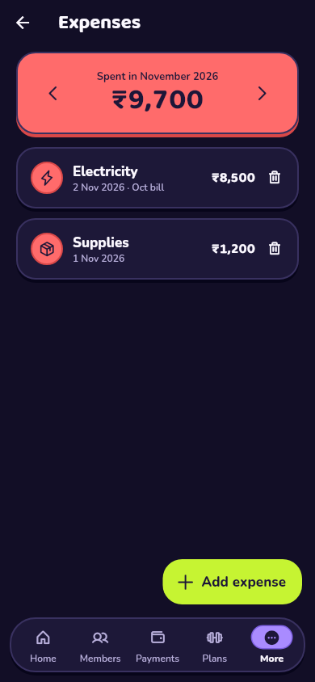 | 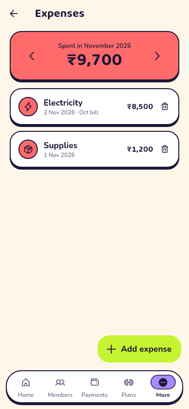 |
| Payment history |  | 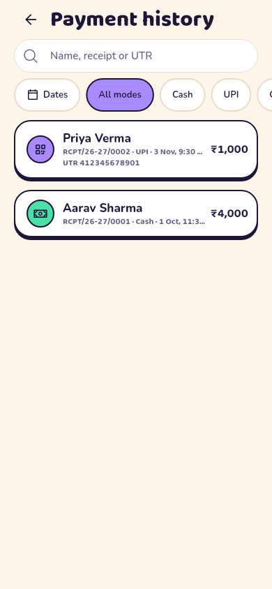 |
| Member Payments tab | 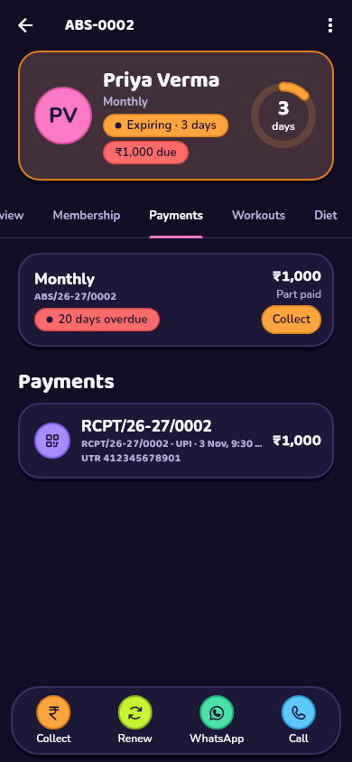 | 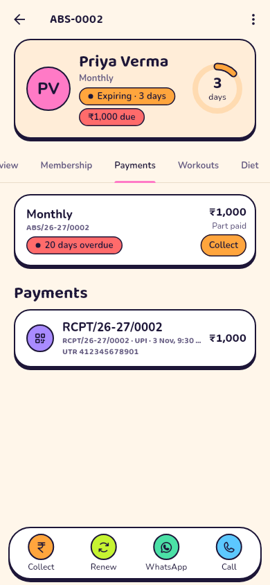 |
| Member home with dues | 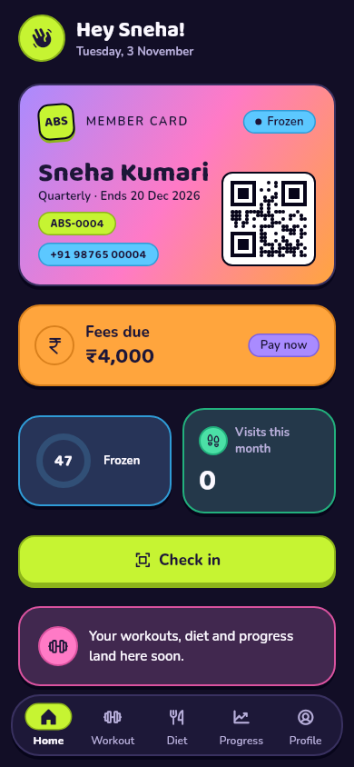 | 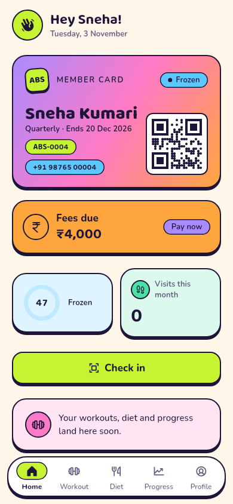 |
| My payments |  | 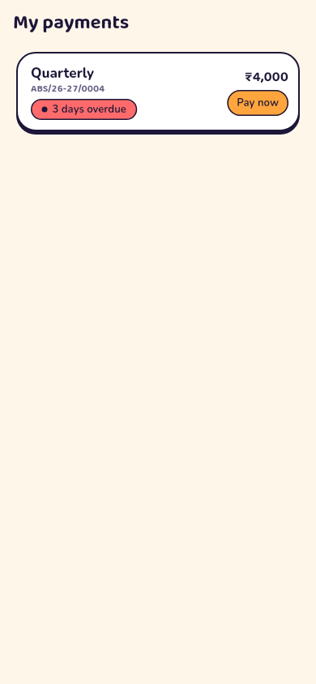 |
| Pay fees | 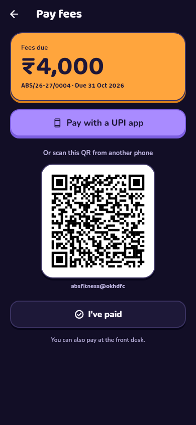 | 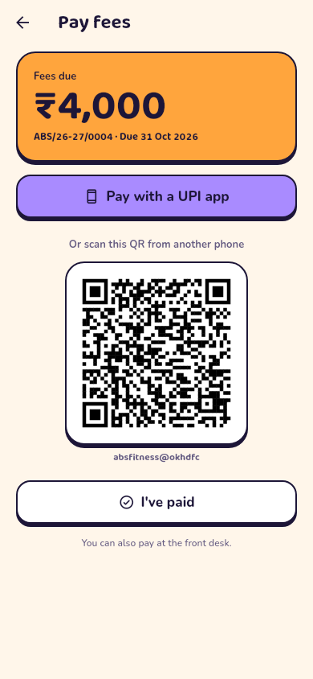 |

## Not in M2 (see DECISIONS 60)

- Sending fee reminders automatically. M2 lists today's reminders with
  one-tap WhatsApp; automatic sending comes with WhatsApp in M5.
- Full revenue reports and exports (M7). M2 adds the summary hooks they
  will use.
- A screen for raising ad-hoc invoices (the database function exists).
- Razorpay checkout inside the member app, and offline collection.

## Not verified here

- **An Android build:** this sandbox can't reach Google's SDK servers. The
  `main` CI job builds the APK.
- **Against a live Supabase project.** The SQL runs on Postgres 16 with a
  stubbed `auth` schema. `pg_cron` and Realtime are set up only when
  present.
- **Razorpay end to end.** The webhook and link code are tested with signed
  sample payloads, but no real Razorpay account was used.
- **Real UPI apps, sharing and printing.** Opening a UPI app, the share
  sheet and the print dialog need a device.
