# M3 Exercise library and workouts: milestone report

Scope from the spec (§8): "F4 and F5, member app shell and workout
player". The changelog lists what was built for each item; "Not in M3"
lists what moved to a later milestone (see DECISIONS 83).

## Changelog

**Database**
- **Catalogue (4.1)** in `supabase/migrations/20261106000001_m3_exercise_seed.sql`,
  generated from free-exercise-db (public domain, pinned commit). 876
  exercises, each with:
  - main and other muscles, equipment, level, type, mechanic, force;
  - instructions and two images;
  - a tracking type: reps and weight, reps, time, or distance and time.
- **Schema** in `supabase/migrations/20261106000000_m3_workouts.sql`:
  - **Custom exercises (4.5)** by the owner and trainers. The database
    marks them and records who made them, and seeded exercises can't be
    rewritten (only the owner can add a Hindi name or a video).
  - **Hindi names (4.7)**, **favourites (4.6)** and **"equipment we have"
    (4.3)**.
  - **Templates (5.1–5.3):** days and items with sets, reps or a range, time
    or distance, target kg, RPE, rest, tempo, notes, warm-up / main /
    cool-down, supersets, weeks, and a weekly progression rule.
  - **Six starter templates:** Beginner fat loss, Muscle gain 4-day, Women's
    strength, Senior mobility, Push / Pull / Legs, Full body 3x.
  - **Programs (5.4):** assigned as a private copy, with weekdays, replace
    or queue, end a program, and a nightly refresh.
  - **Workout logs (5.7):** saved from the phone with a client id (retries
    never duplicate), partial or complete, and editable for 24 hours.
  - **Personal records (5.9):** detected on save (heaviest, best estimated
    1RM, more reps at a weight).
  - **Trainer comments and reactions (5.10).**
  - **Adherence and the coach overview (5.5):** program, last workout,
    workouts this week, adherence, planned today, and missed this week.
  - **Row Level Security:** logs are visible only to the member, their
    trainer and the owner.
  - **Storage:** a public `exercises` bucket, with
    `scripts/mirror_exercise_images.sh` to fill it.

**App**
- **Training tab** (the staff Plans tab), with three parts:
  - **My members:** each member's program, last workout, this week and an
    adherence ring. The owner can filter by trainer.
  - **Programs:** the template library, with starters first.
  - **Exercises:** the library.

  The front desk can browse; only coaches build and assign.
- **Exercise library (4.2–4.6).**
  - Search 876 exercises (works offline after the first sync).
  - An original front/back body map: tap a muscle and it glows and filters
    the list.
  - Chips for Favourites and Equipment we have, and a filter sheet for
    equipment, level and type with a live count.
  - The owner can edit the gym's equipment.
  - Pages of 30 and pull-to-refresh.
- **Exercise detail (4.4):**
  - start and end images alternating like a two-frame animation;
  - muscles worked on the front and back figure;
  - numbered steps, tips, common mistakes and a YouTube link;
  - alternatives (same muscle, different equipment);
  - for members, their own best weight, best 1RM, number of sessions and a
    trend.
- **Custom exercise form (4.5):** name, Hindi name, muscles, equipment, how
  it's logged, level, type, steps, tips, mistakes, YouTube link and a photo.
- **Program builder (5.1, 5.2).**
  - Up to 7 days: add, rename and remove.
  - Add exercises with a multi-select picker that has the full library
    inside it.
  - Hold and drag to reorder.
  - A per-exercise sheet for sets, reps or time, targets, RPE, rest, tempo,
    block and superset.
  - Weeks, and the progression rule (+kg or +reps a week).
  - Unsaved changes ask before discarding.
- **Template detail (5.3, 5.12):** days and exercises; assign, duplicate
  (opens the builder on the copy), edit and remove; share as a PDF or as
  WhatsApp-ready text.
- **Assign sheet (5.4):** pick members, a start date, exactly N training
  days, and replace or queue.
- **Member detail → Workouts (5.5, 5.10, 5.11).**
  - Program summary with adherence, streak and this week.
  - Tune the member's own copy, assign, end, or share.
  - Days with today's highlighted.
  - The plan-vs-done month calendar.
  - Workout history; a workout's sheet shows its sets and PRs, and coaches
    can comment and react.
- **Staff home:** "Training today" for coaches, showing who is planned (with
  a tick when done) and who missed sessions this week.
- **Member app.**
  - **Workout tab:** today's workout (start, resume, rest day with "start
    next instead", or done), the program summary, plan vs done, days with a
    start button each, history, and the exercise library.
  - **Home:** today's workout card. Workouts finished offline upload when
    the app opens.
  - **Progress:** workouts per week, streak, adherence and recent PRs.
- **Workout player (5.6, 5.7).**
  - Full screen; swipe between exercises with their alternating images.
  - Set rows prefilled from last time, with the week's target shown.
    Steppers, or tap to type a value.
  - Tick a set to start the rest ring, with +15 s and Skip. It keeps time
    when the phone is locked and sends a notification when rest ends.
  - Supersets rest only after their last exercise. Next-up preview.
  - Leave and resume later, save as partial, or discard.
  - Finish shows time, kg lifted, sets, PRs (from the server, or worked out
    on the phone when offline) and confetti.
  - Works offline from start to finish, through the outbox.
  - A finished workout can be reopened and fixed for 24 hours.

**Fixes found while building**
- Two dialogs disposed their text field controller while still closing,
  which crashed the next screen. A shared dialog now owns its controller.
- A database test depended on the time of day: just after midnight IST,
  "two hours ago" is yesterday. It now pins the date.
- The code generator doesn't always use the project's 120-column line
  width, which could fail CI's "generated code is up to date" check on
  formatting alone. CI now formats generated files with the project's
  settings before comparing them.

## Tests

| Suite | Count | New in M3 |
| --- | --- | --- |
| `test/unit/` | 86 | Epley 1RM; +kg / +reps progression; program week; weekday schedule and default weekdays; adherence (matches the database example) and streak; workouts per week; PR rules (baseline, heaviest, reps at weight, e1RM, bodyweight, best set only); the player session (prefill, week targets, superset rest, payload, save/restore); outbox (retry, dedupe, drops refused); library search under 100 ms on 876, ranking, filters, Hindi names, alternatives, image URLs, YouTube check; client ids are UUIDs |
| `test/widget/` | 65 | 14 M3 flows: library search, body map, favourites; exercise detail with own progress; trainer adds a custom exercise; desk can browse but not build; builder with a superset; duplicate and assign with weekday rules; member Workouts tab with a coach reaction; desk sees the program but not logs; player prefill, rest timer and alert, PR and celebration; fixing a workout within 24 hours; offline finish then upload and resume; coach My members and Training today; member without a program |
| `test/goldens/` | 104 | 28 new screenshots (light and dark): My members, programs, exercise library with a muscle selected, exercise detail, custom exercise, template detail, program builder, assign, member Workouts tab, member Workout tab, player, rest timer, workout summary with a PR, member library |
| `supabase/tests/rls_m3_test.sql` | 91 checks | Seed counts, images, tracking types and starter templates; who reads the catalogue; custom exercises (owned, can't rewrite the seed, valid muscles and YouTube); favourites are private; templates (desk reads, can't build, validation, author or owner edits, duplicate); assigning (role checks, weekdays, private copy, editing a copy leaves the library alone, queue, replace, end, future start, nightly refresh); logs (idempotent, volume, PRs of every kind, 24 h edit lock, time checks); who sees logs (member, trainer, owner; not the desk or other members); comments; adherence; the coach overview (planned today, missed); anon |
| Edge Functions | 7 | — |

The analyzer is clean. Database totals: 298 checks across M0–M3.

## Screenshots

In [`test/goldens/screens/`](../../test/goldens/screens):

| Screen | Dark | Light |
| --- | --- | --- |
| My members | 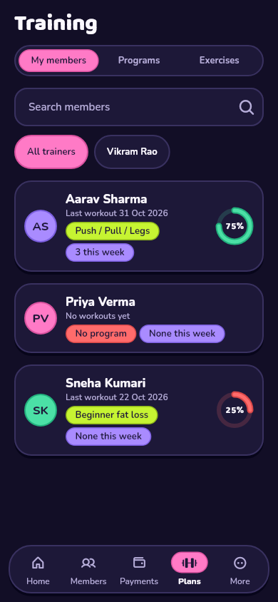 | 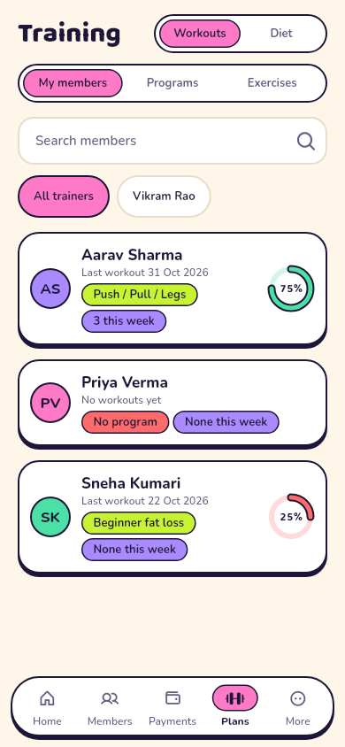 |
| Programs | 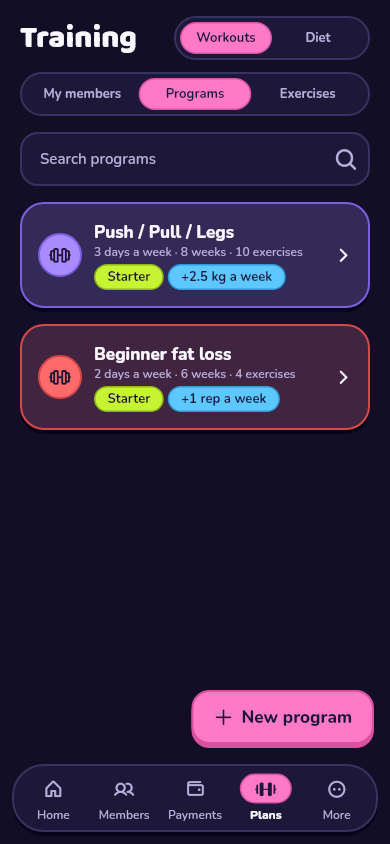 | 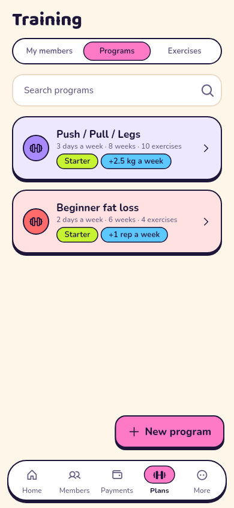 |
| Exercise library | 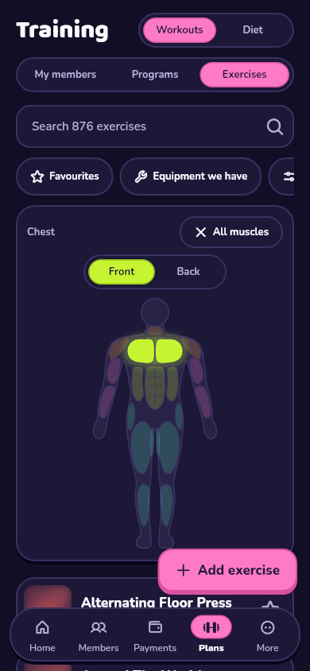 | 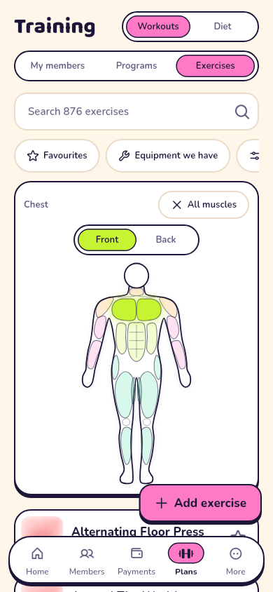 |
| Exercise detail | 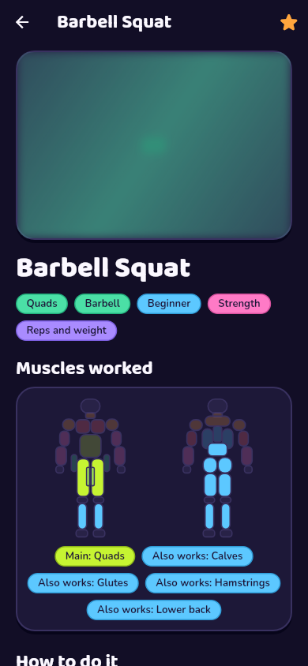 | 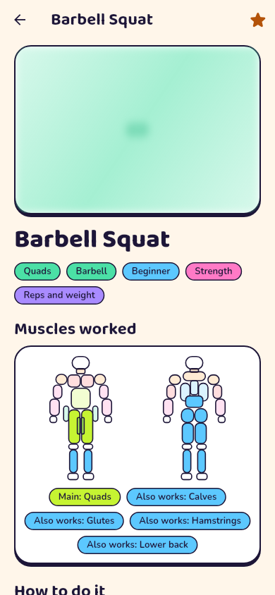 |
| Custom exercise | 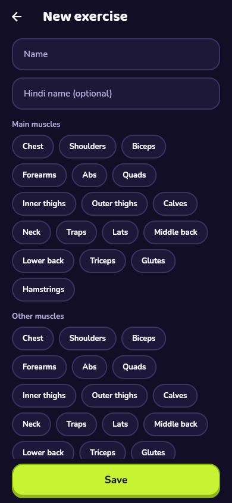 | 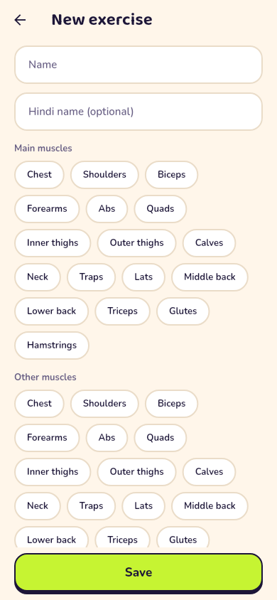 |
| Template detail | 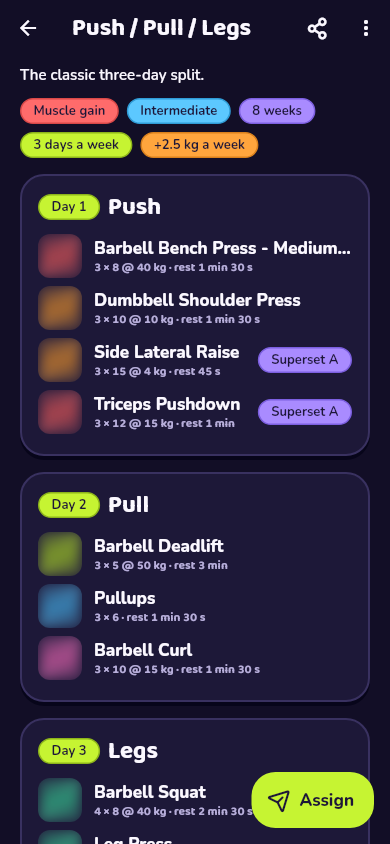 | 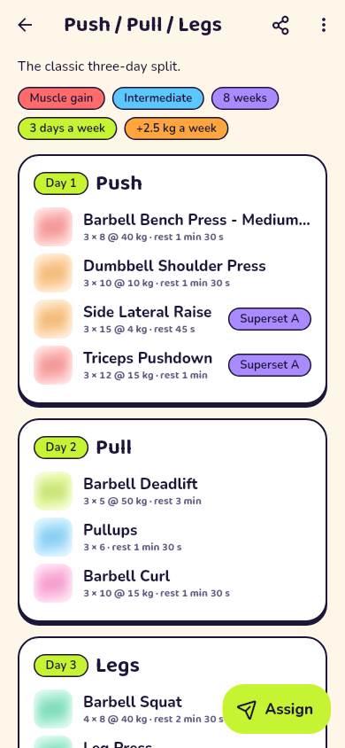 |
| Program builder | 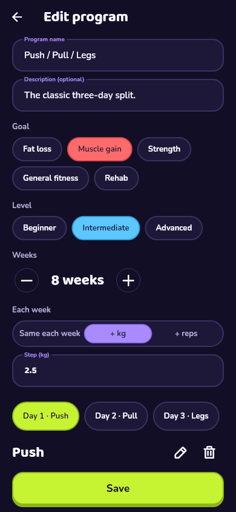 | 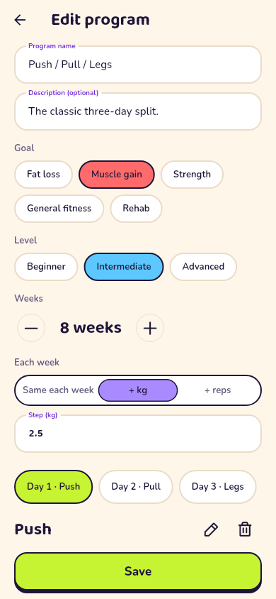 |
| Assign | 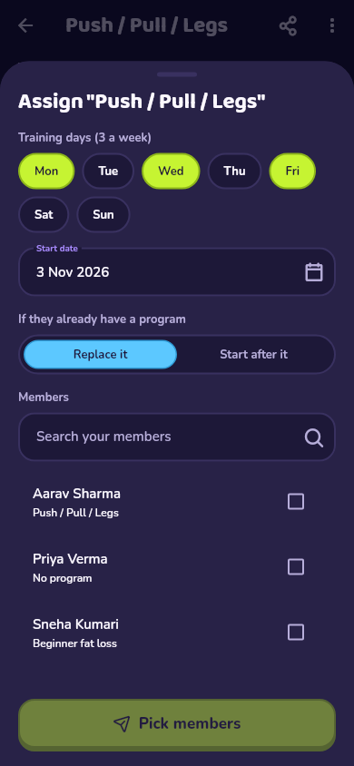 | 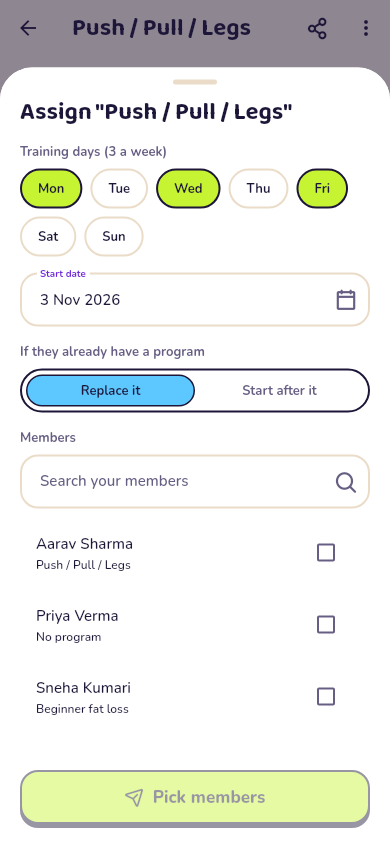 |
| Member Workouts tab | 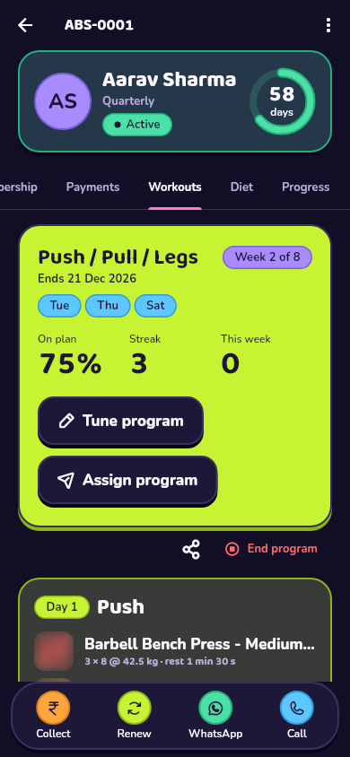 | 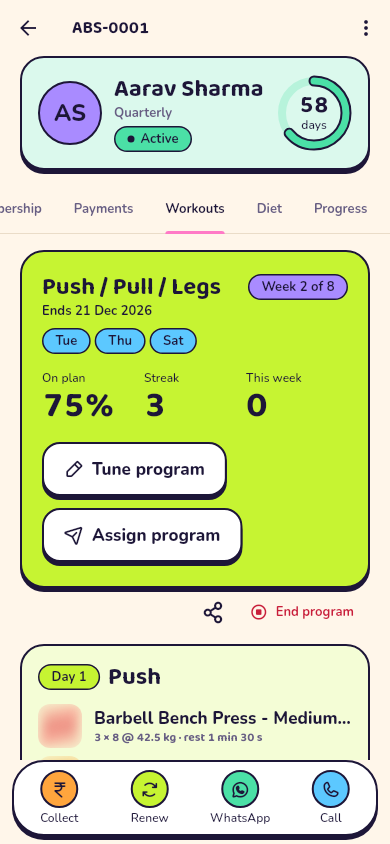 |
| Member Workout tab | 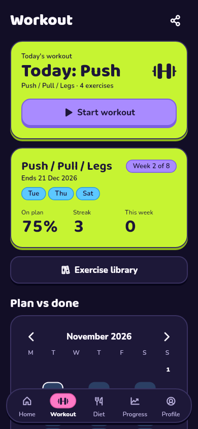 | 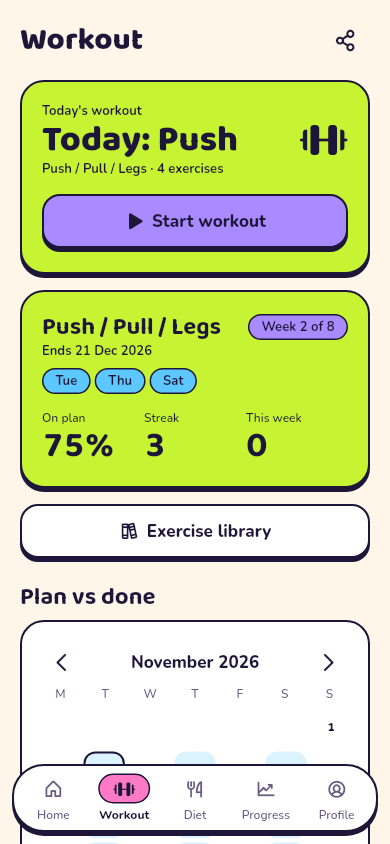 |
| Player | 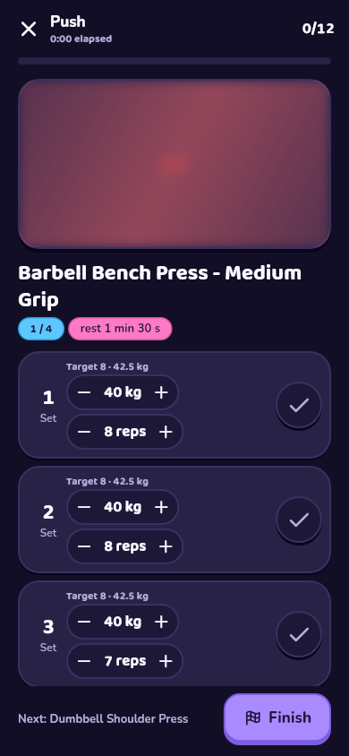 | 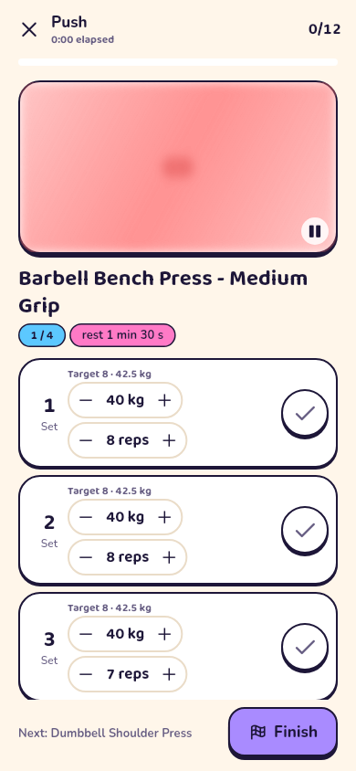 |
| Rest timer | 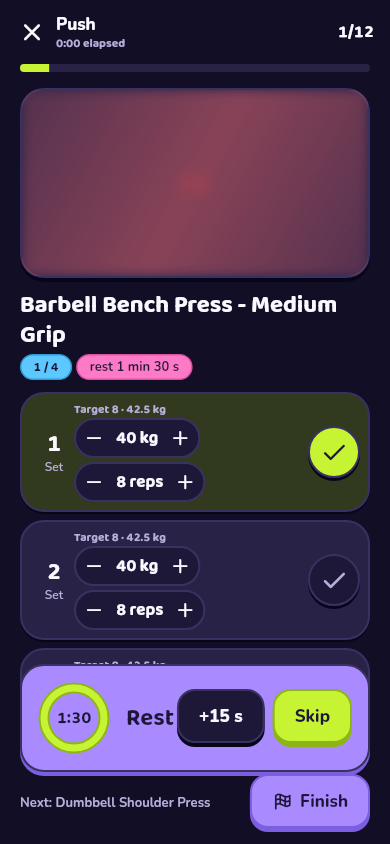 | 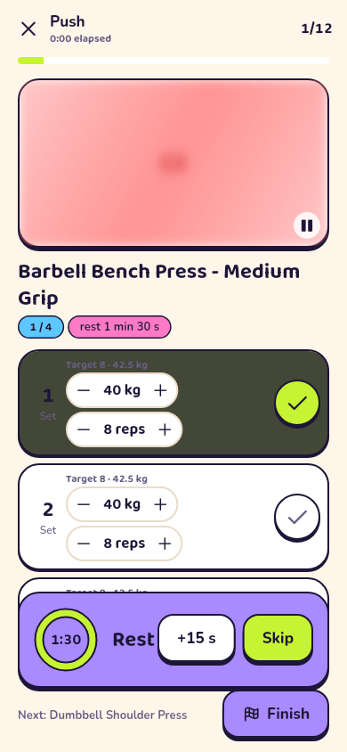 |
| Workout summary | 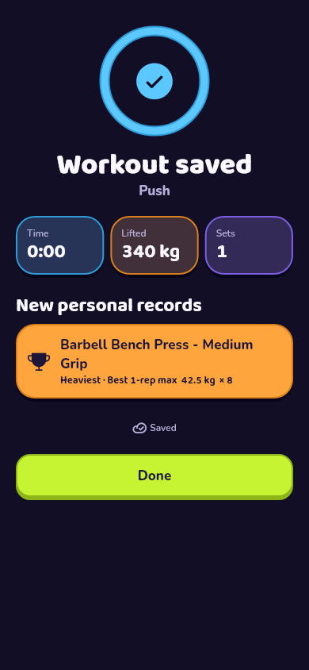 | 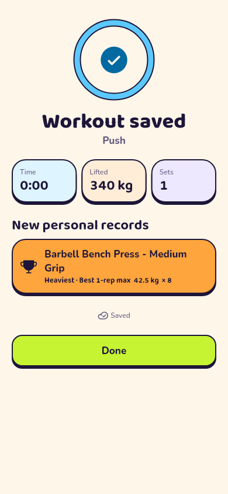 |
| Member library | 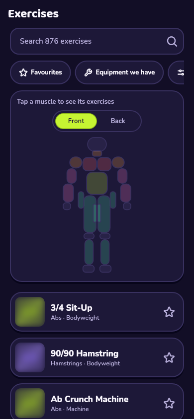 | 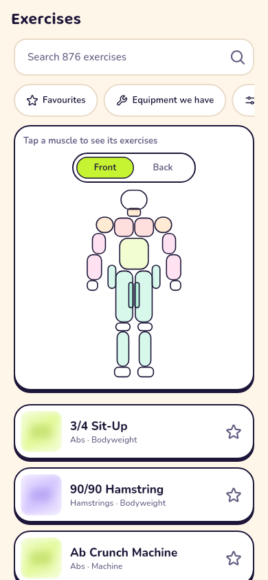 |

Screenshots show placeholders instead of exercise photos, because network
images are off in tests.

## Acceptance criteria

- **Library opens offline after first sync; search under 100 ms; blur-up
  images.** The catalogue is cached on the phone. Search was measured in a
  unit test at well under 100 ms on all 876 exercises. Images load lazily
  over a blurred placeholder.
- **Build and assign a 4-day program from templates in under 3 minutes.**
  From the template, it's Duplicate → tweak in the builder → Save → Assign
  → pick members → Assign.
- **The player works fully offline and syncs later.** Covered by the
  offline flow test: the session is saved on the phone, the outbox holds
  the workout, and it uploads with the same id.
- **The rest timer keeps running when the phone is locked.** It is
  calculated from an end time, and a local notification fires at the end.
  The notification needs a real device to verify.

## Not in M3 (see DECISIONS 83)

- Push notifications: new programs and coach comments show in the app.
- Members uploading their own exercise videos (YouTube links instead), and
  an embedded player.
- Members replying to comments, and trainers logging for a member.
- The general drift offline cache.

## Not verified here

- **An Android build, including the new notification plugin and
  desugaring:** CI on `main` builds the APK.
- **Real exercise images:** they need the mirror script run against your
  Supabase project.
- **The lock-screen rest alert, haptics, sharing and printing:** these
  need a phone.
