# M4 Diet: milestone report

Scope from the spec (§8): "F6 with food seed, plan builder, member diet
tracking". The changelog lists what was built for each sub-feature; "Not in
M4" lists what moved to a later milestone (see DECISIONS 103).

## Changelog

**Database**
- **Food database (6.1)** in `supabase/migrations/20261107000001_m4_food_seed.sql`,
  generated from `supabase/seed/foods.csv` by `scripts/gen_food_seed.py`.
  - 300 common Indian and everyday foods, each with:
    - a Hindi name;
    - the serving people use (1 katori, 1 roti, 1 glass, 100 g) and its
      grams;
    - kcal, protein, carbs, fat and fibre;
    - vegan / veg / egg / non-veg, Jain-friendly and allergens;
    - what to buy for the grocery list.
  - Every food's calories are checked against its macros.
  - Seeded foods are marked **not reviewed** until the gym's dietitian or
    a trainer checks them.
  - `scripts/import_usda_foods.py` adds USDA FoodData Central items from
    the official download.
- **Schema** in `supabase/migrations/20261107000000_m4_diet.sql`:
  - **Custom foods**: coaches add them and correct any food's values (which
    counts as reviewing it). The owner, or a custom food's author, removes
    foods.
  - **Allergies and foods to avoid (6.4)** on the health form.
  - **Diet templates (6.3, 6.5, 6.6)**: meals by slot with time and notes,
    foods with amounts, up to two "or" options per meal, targets, macro
    preset and supplements.
  - **Six starter templates**, each within 5% of its calorie target:
    - Veg fat loss 1,500 kcal
    - Eggetarian fat loss 1,800 kcal
    - Veg balanced 2,000 kcal
    - Non-veg muscle gain 2,500 kcal
    - Jain balanced 1,800 kcal
    - Vegan high protein 2,200 kcal
  - **Assigning (6.7)**: a private copy per member. It replaces the
    running plan, or queues it for a future start, and can be ended. A
    nightly refresh starts queued plans, and earlier plans stay in the
    history.
  - **Meal, water and supplement logs (6.8, 6.9)**, written by the
    member's phone for today and the two days before. Each meal log keeps
    the calories eaten.
  - **Trainer comments (6.11)**, **adherence**, and the **nutrition
    overview** for coaches.
  - **Health flags**: preference, allergies, foods to avoid and medical
    conditions, for the builder and the assign sheet.
  - **Row Level Security**: plans, logs, comments and allergies are
    visible only to the member, their trainer and the owner. The front desk
    reads the template library only.

**App**
- **Training tab, Diet area** (a Workouts / Diet switch):
  - **My members (6.11)**, for coaches: plan, adherence this week, meals
    marked today, missed meals and a health-condition flag. The owner can
    filter by trainer.
  - **Diet plans**: the template library, with starters first.
  - **Foods**: search 300 foods in English or Hindi (works offline after
    the first sync), food groups, "Not reviewed (n)" and custom filters,
    and pages of 30. Each food opens a sheet with values per serving and
    per 100 g, allergens, what to buy, and review status. Coaches mark a
    food reviewed or edit it.
- **Food editor (6.1)**: name, Hindi name, group, serving unit and grams,
  values, type, Jain-friendly and allergens. It warns live when calories
  don't match the macros.
- **Plan detail (6.3, 6.6)**:
  - planned vs target rings, meals with their options, supplements and the
    disclaimer;
  - assign, **duplicate & scale** to a new calorie target, edit, remove;
  - share as a PDF or WhatsApp text, or as a grocery list.
- **Plan builder (6.3–6.5)**:
  - meals in the order of the day, with times and notes; add or remove
    meals;
  - add foods with a multi-select picker. Foods that don't suit the
    member, or the plan's preference, are marked, and "Suits {preference}"
    filters them out;
  - −/+ steps by the food's unit (half roti, one egg, 25 g), or type an
    amount;
  - up to two "or" options per meal: pick foods, or **suggest one**
    automatically;
  - targets with the **calculator (6.2)** and "Scale foods to target";
  - preference, goal and supplements;
  - a **live totals bar** (kcal and P/C/F rings) that updates in the same
    frame;
  - for a member's plan: the health flag, their preferences, and a
    warning when foods don't suit them.
- **Targets calculator (6.2)**: sex, age, height, weight (pre-filled from
  the member), activity, goal, macro preset and protein per kg. It shows
  BMR, maintenance, the calorie target and P/C/F.
- **Assign sheet (6.7)**: start date and members, with warnings for health
  conditions and for foods that don't suit a member.
- **Member detail → Diet (6.4, 6.11)**:
  - the health flag and editable food preferences;
  - the plan with adherence, missed meals and water this week;
  - adjust their copy, assign another, end it, share it;
  - today's meals;
  - the weekly adherence chart with the weight trend;
  - coach notes, and earlier plans.
- **Member app → Diet (6.8–6.10, 6.12, 6.13)**:
  - pick today, yesterday or the day before;
  - daily kcal and P/C/F rings that fill as meals are marked;
  - **today's meals as a vertical timeline**. Tap a meal to mark it Eaten,
    Partly, Skipped or Swapped (to option 1 or 2), or to clear it;
  - a **water glass** that fills with a wave, with a goal from the
    member's weight;
  - the supplement checklist, coach notes and the weekly chart;
  - **meal reminders** (a bell; daily local notifications at the plan's
    meal times);
  - the **grocery list** for the week, shared to WhatsApp;
  - the plan as a PDF or text, and the member's own food preferences;
  - a "New plan from your coach" banner.

  Everything works offline: marks show at once and upload through the
  outbox.
- **Member home**: today's meals card (calories so far and the next meal).
  Marks made offline upload when the app opens.
- **Hindi food names** render with a bundled Devanagari font (Noto Sans
  Devanagari, OFL).

**Fixes found while building**
- A permission check in a new database function treated "unknown" as
  "allowed" when a trainer (who has no member id) called it, which let
  them change another trainer's member's food preferences. The checks are
  now null-safe, and a test covers it.

## Tests

| Suite | Count | New in M4 |
| --- | --- | --- |
| `test/unit/` | 119 | 33 diet tests: the seed (300 foods, calories match macros, steps, groups, allergens); starter plans (within 5%, foods fit the preference, at most two options); meal, option and day totals; marks count like the database; payload order; BMR, TDEE, calorie goals and the deficit floor; macro presets and the protein cap; age; **scaling 1,800 → 2,200 kcal rounds to half rotis and 25 g**; scaling down keeps one step; preference rules incl. Jain; allergy and avoid conflicts (English and Hindi); member flags override the plan; swap suggestions; adherence and missed meals (the database example); weekly chart; water goal; grocery list and amounts; food search ranking, Hindi, filters and speed; outbox (last tap wins, offline, refusals) |
| `test/widget/` | 83 | 18 diet flows: member timeline and marking with rings; swapping and clearing; yesterday, water and supplements; offline marks then upload; meal reminders on and off; grocery list and own preferences; no plan; home card; coach overview → member Diet tab with chart and a note; desk sees libraries but not members' diets (and can't open the builder); duplicate & scale 1,500 → 1,800 kcal; builder with totals updating in one frame and a suggested option; medical-condition flag; preference clash warning; targets calculator; assign with health and food warnings; foods search in Hindi, review, custom food with the calorie check; ending a plan |
| `test/goldens/` | 132 | 28 new screenshots (light and dark): Training → Diet members, diet plans, foods, food sheet, food editor, plan detail, builder, a member's plan in the builder, targets calculator, assign, member detail → Diet, member Diet tab, meal sheet, grocery list |
| `supabase/tests/rls_m4_test.sql` | 125 checks | Seed (counts, review state, calorie check, units and steps, Hindi names, grocery, starter plans in range and fitting their preference, options); who reads what (member, desk, trainers, owner, anon); custom foods (source, review, protected fields, removal rights, allergen list); templates (build, validation of meals, slots, options, amounts and targets, author or owner edits); assigning (role checks, private copy, history event, editing a copy leaves the library alone, future start, dropping a queued plan, nightly refresh, end); meal logs (eaten, partly, swapped, skipped, clear, one per meal per day, options and slots checked, two-day window, plan dates, logs follow the running plan); water and supplements; preferences and flags; comments; adherence and the nutrition overview; privacy for the desk and other members |
| Scripts | 2 | The food seed matches `foods.csv`, and the USDA importer self-test (both run in CI) |
| Edge Functions | 7 | — |

The analyzer is clean. Database totals: 423 checks across M0–M4.

## Screenshots

In [`test/goldens/screens/`](../../test/goldens/screens):

| Screen | Dark | Light |
| --- | --- | --- |
| Training → Diet: members | 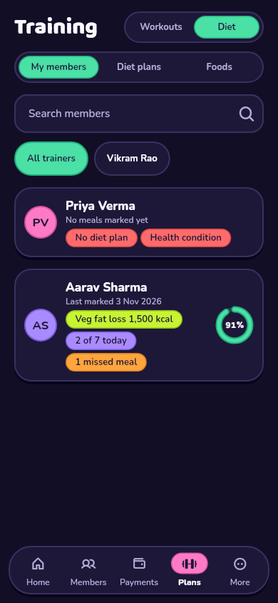 | 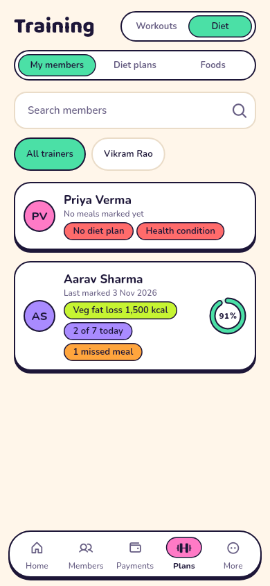 |
| Diet plans | 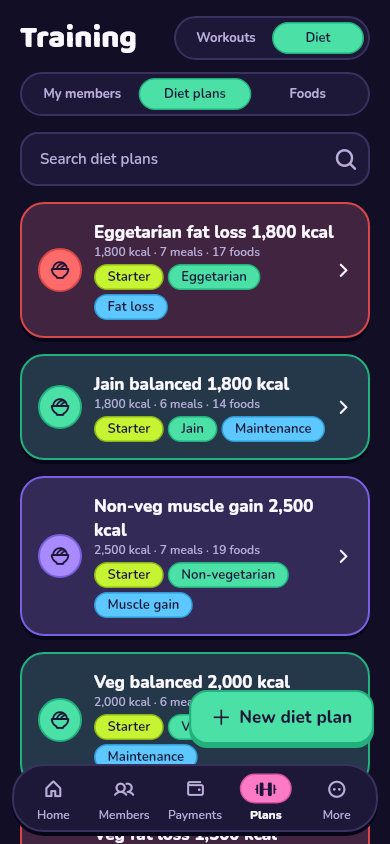 | 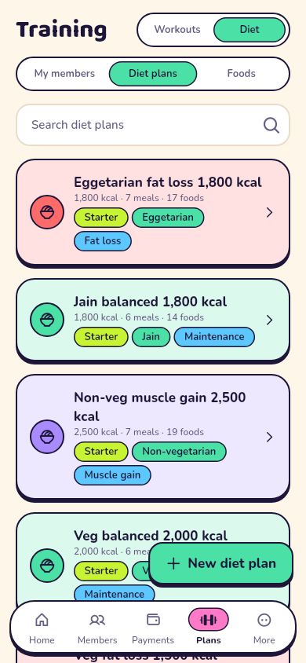 |
| Foods | 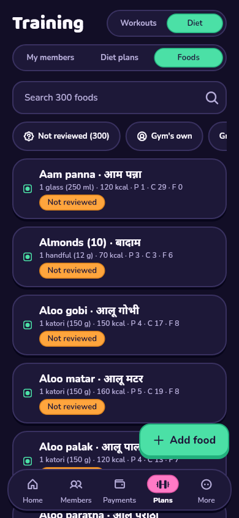 | 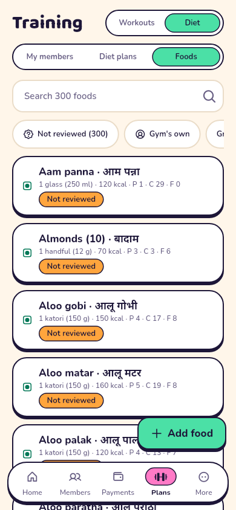 |
| Food sheet | 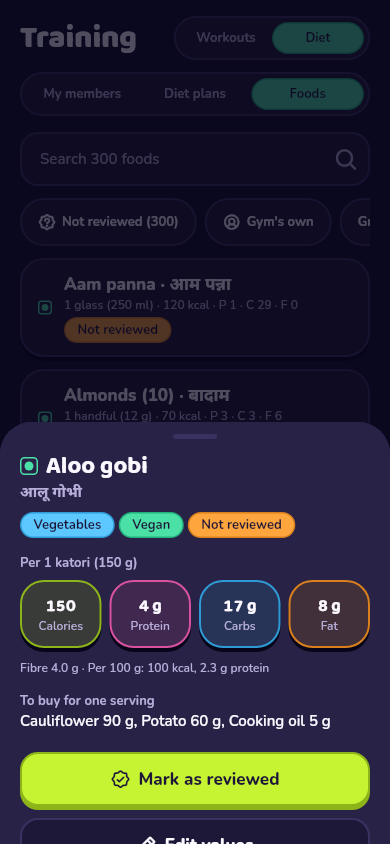 | 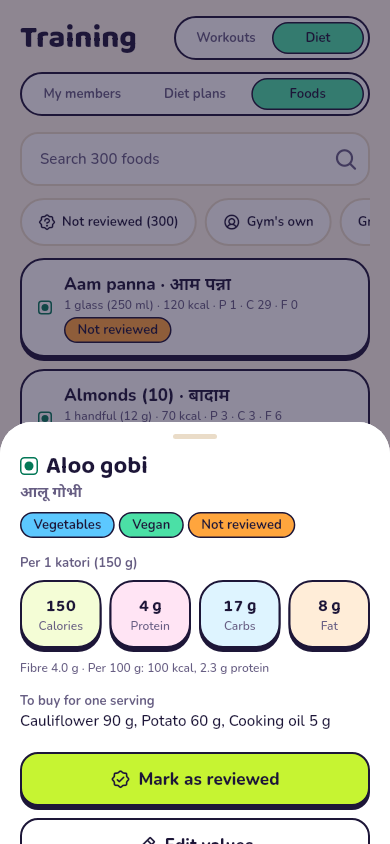 |
| Food editor | 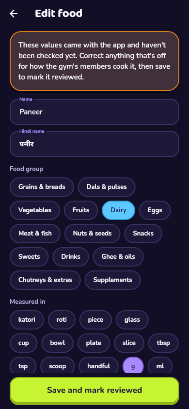 | 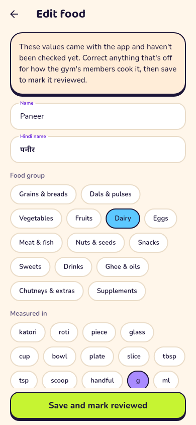 |
| Plan detail | 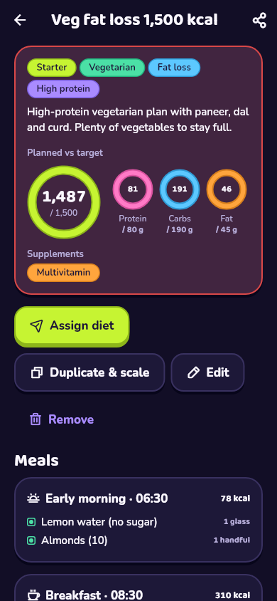 | 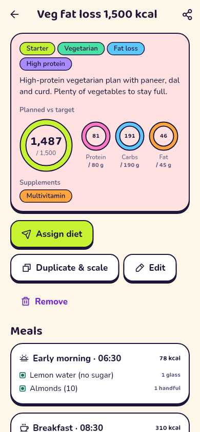 |
| Plan builder | 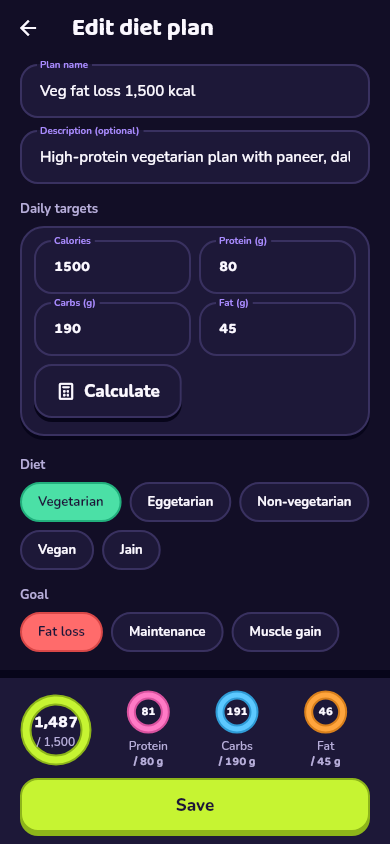 | 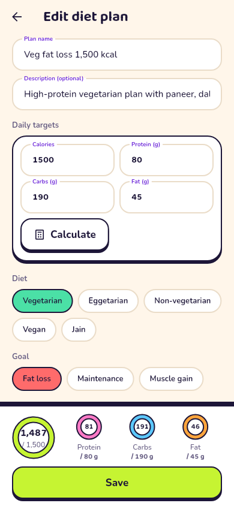 |
| A member's plan | 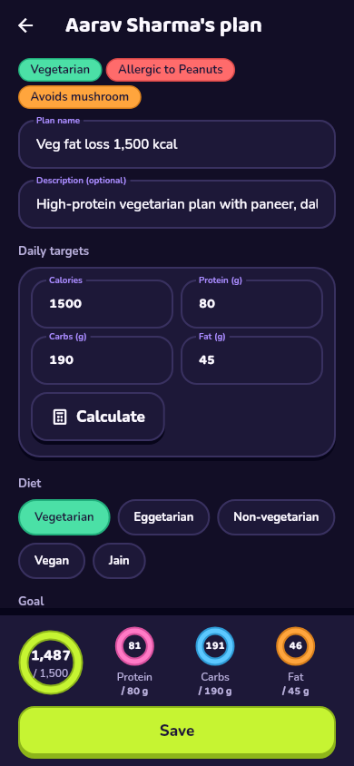 | 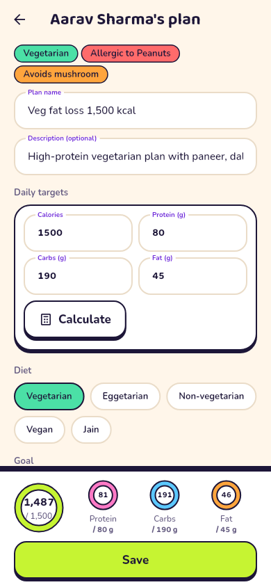 |
| Targets calculator | 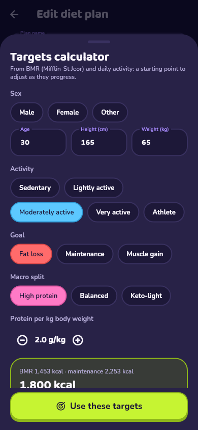 | 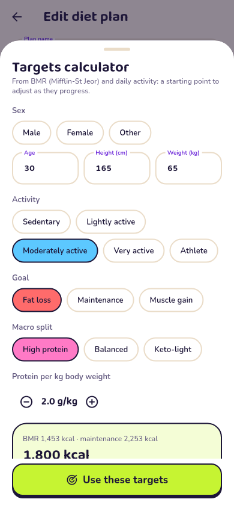 |
| Assign | 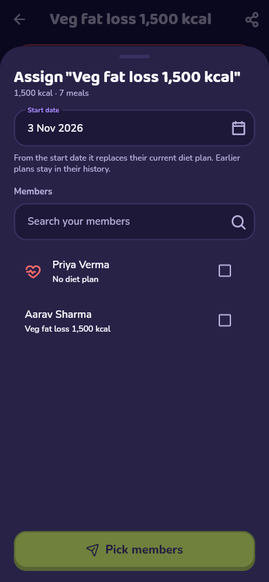 | 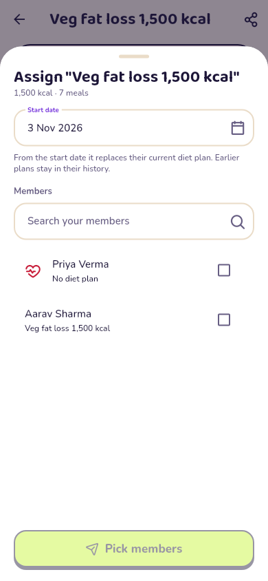 |
| Member detail → Diet | 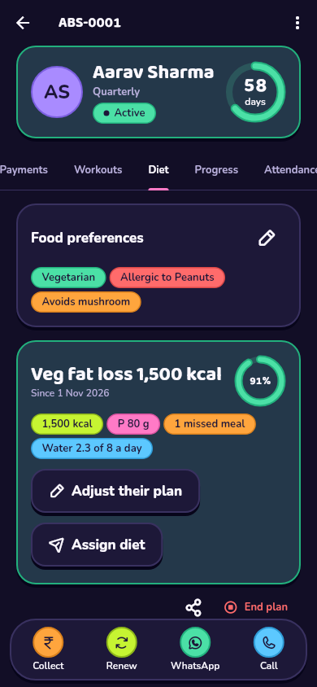 | 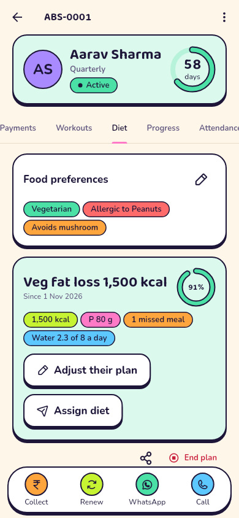 |
| Member Diet tab | 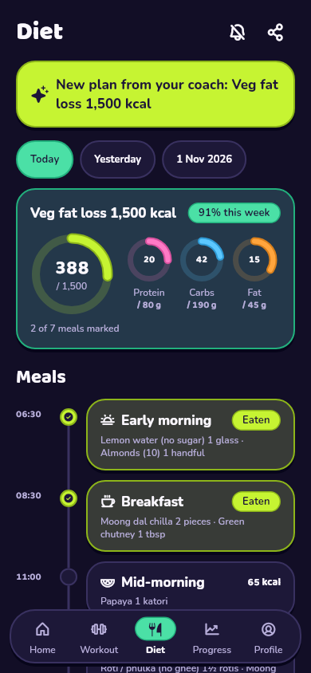 | 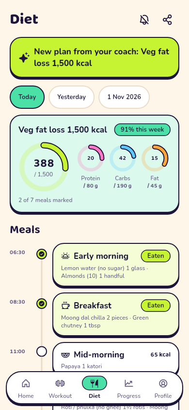 |
| Mark a meal | 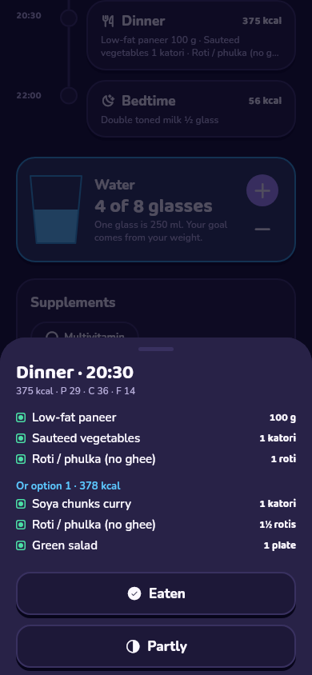 | 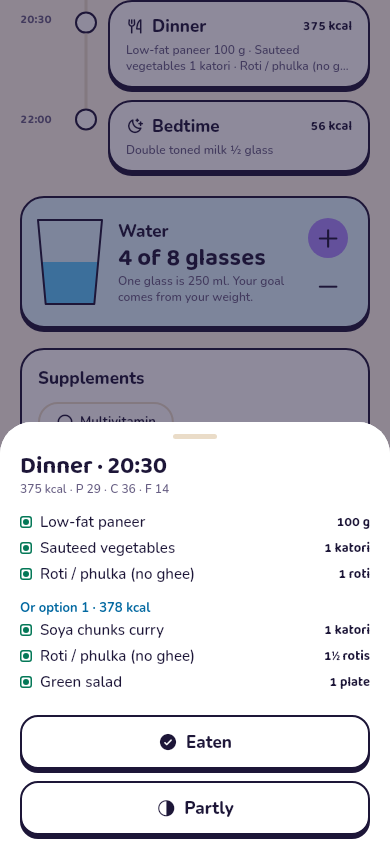 |
| Grocery list | 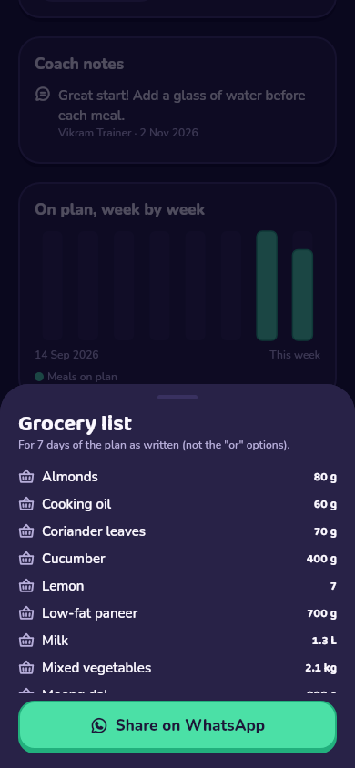 | 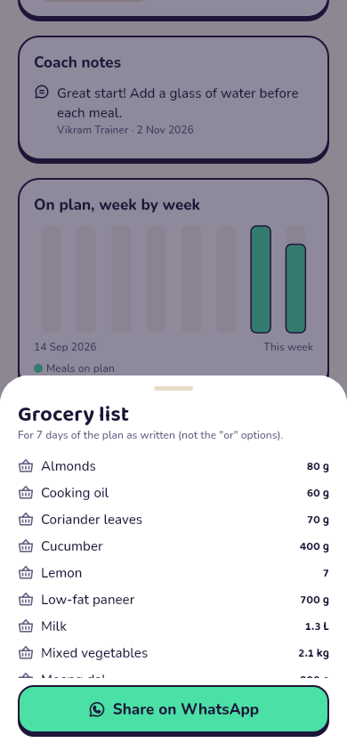 |

The three earlier Training screenshots changed only to show the new
Workouts / Diet switch.

## Acceptance criteria

- **Totals update within one frame when quantities change.** The builder
  works the totals out in the same build as the change. A widget test taps
  + and checks the new total after a single frame.
- **Scaling a template from 1,800 to 2,200 kcal adjusts quantities
  proportionally and rounds to sensible units (half roti, 25 g steps).** A
  unit test scales a 1,800 kcal plan to 2,200: 2 rotis become 2½, 100 g of
  paneer becomes 125 g, 2 eggs stay 2, and the name and macro targets
  follow. The widget test duplicates a starter from 1,500 to 1,800 kcal in
  the app.
- **A medical disclaimer is shown on every diet plan, and the plan builder
  flags members with medical conditions from F1 1.2.**
  - The disclaimer is on the plan detail, the builder, both Diet tabs, the
    shared text and the PDF.
  - The flag (conditions, medicines or a PAR-Q yes) shows in the builder,
    the assign sheet and the nutrition overview, covered by widget and
    database tests.

## Not in M4 (see DECISIONS 103)

- Push notifications: new plans show in the app as a banner.
- Plans that change by weekday.
- Editing a custom food's grocery ingredients (it buys the food itself).
- Members logging foods outside their plan.

## Not verified here

- **An Android build:** CI on `main` builds the APK.
- **Meal reminders on a phone:** they use the same notification plugin as
  M3's rest alert.
- **Sharing, printing the PDF, and haptics:** these need a phone.
- **The food values themselves:** they are typical recipes and portions,
  and need the dietitian's review before launch, as the spec asks.
- **The USDA importer against a real FoodData Central download:** USDA's
  site is blocked from the build machine. The script's self-test uses a
  small sample in the official CSV layout.
