# M5 WhatsApp: milestone report

Scope from the spec (§8): "F8 free mode end to end; API mode behind a
toggle." The changelog lists what was built for each sub-feature; "Not in
M5" lists what moved to a later milestone (see DECISIONS 120).

## Changelog

**Database** (`supabase/migrations/20261108000000_m5_whatsapp.sql`)
- **One queue for both modes (8.9, 8.10, 8.13).** `message_queue` holds every
  message with its member, template, language, category (utility or
  marketing), text, channel (free-mode link or API), due time and status:
  queued, sending, sent, delivered, read, failed, skipped or cancelled. It
  is also the message log.
- **Templates (8.1).** Twelve automatic messages in English and Hindi:
  - membership ending soon, ending today, ended;
  - fee reminder with the UPI pay link, or "pay at the desk" when the gym
    has no UPI ID;
  - payment received, welcome, renewal thanks, new workout program, new diet
    plan;
  - birthday and festival wishes (marketing).

  Variables (`{first_name}`, `{plan}`, `{end_date}`, `{amount}`,
  `{pay_link}`, `{gym_name}`…) are filled per member in their language,
  with English as the fallback. Dates read like the app (3 Nov 2026) and
  amounts in Indian grouping (₹1,23,456).
- **The daily queue (8.2, 8.3, 8.5, 8.6)** at 07:30 IST (`pg_cron`), timed
  for 09:00. It holds:
  - expiry reminders on the owner's days (default 7 and 3 days before, on
    the day, 3 days after);
  - fee reminders on the dues days, with a UPI link for the instalment due;
  - birthdays, including 29 February in other years;
  - festival wishes from the calendar, with the Hindi name for Hindi
    members.

  Running it again adds nothing. Unsent automatic messages from earlier
  days are dropped (DECISIONS 115).
- **Confirmations (8.4)** are queued the moment a payment is recorded or a
  membership starts or renews. A workout or diet plan being assigned also
  queues one. Each confirmation can be switched off.
- **Paying stops reminders (8.3).** Paying or voiding an invoice cancels
  its waiting reminder, and the sender checks again just before sending.
- **The spec's limits.** The same template goes to a member at most once in
  24 hours, and marketing at most once a day. A birthday beats a festival.
- **Broadcasts and segments (8.8).** Segments: everyone, active, ending in 7
  days, expired 30–90 days ago, with fees due, a trainer's members, a
  batch, or picked members. A preview counts who the message reaches, and
  the broadcast queues one message per member.
- **Festival calendar (8.6):** one year of Indian festivals, editable, each
  with its own message and segment (Eid starts off; DECISIONS 118).
- **Opt-in and opt-out (8.12).** Messages need consent and WhatsApp on.
  Opting out cancels anything waiting and shows once in the member's
  history. Members, the desk, or a STOP / START reply switch it.
- **API-mode hand-off (8.10, 8.11).** These functions only the Edge
  Functions can call:
  - claim due messages without double-sending;
  - record each result: retry once, then move to the free-mode list;
  - delivery and read receipts;
  - incoming messages: STOP / START, and opening the 24-hour window.
- **Cost meter (8.14):** this month's API sends by category, free-window and
  hand-sent counts, estimated spend, and the marketing cap. Over the cap,
  due marketing moves to the free-mode list.
- **Row Level Security.**
  - The front desk and owner run WhatsApp, and members read their own
    messages.
  - Templates, festivals and settings are the owner's.
  - Trainers can only log a plan they share with their own member.
  - Every function refuses the public and anonymous roles.

**Edge Functions**
- `whatsapp-send`: sends due API messages through the Meta Cloud API. It is
  called by a scheduled job with `CRON_SECRET`, or by **Send now** with the
  desk's login. In free mode it does nothing.
  - Inside the 24-hour window it sends free text. If Meta says the window
    has closed, it sends the template instead.
  - Outside the window it sends the approved template, with the variables
    in order.
  - Errors are sorted into retry (rate limit, Meta outage), give up now
    (no template, bad number) and stop the run (token refused).
- `whatsapp-webhook`: Meta's verification handshake, a signature check on
  every call (`X-Hub-Signature-256`), receipts, and STOP / START. A
  member's reply sends their due utility messages at once.
- Shared logic is in `_shared/whatsapp.ts` (pure functions) with 14 tests.

**App** (`lib/features/whatsapp/`)
- **More → WhatsApp** (front desk and owner), showing the mode:
  - **To send (8.9):** today's queue, each row with the member, message,
    time and text. **Send** opens WhatsApp with the text ready, and coming
    back to the app ticks the row. **Send to Priya · 3 left** walks the
    queue one message at a time. Rows can be skipped and ticks undone, and
    rollback with an error if the server refuses. "Check for today's
    reminders" builds the queue on demand. API mode adds **Send now** and
    lists what the API couldn't send.
  - **Log (8.13):** every message with the template, time, channel and
    status (queued, sent, delivered, read, failed, skipped), filtered by
    status, in pages of 30.
  - **Broadcasts (8.8):** the history with queued and skipped counts.
- **Broadcast composer (8.8):**
  - title and message, with variable chips;
  - gym update (utility) or offer / wishes (marketing);
  - the segment, with a trainer or batch pick;
  - a live count of who it reaches;
  - now, or 9:00 am on a chosen day;
  - a WhatsApp-style preview with a sample member.
- **Templates (8.1):** each message in English and Hindi. The editor has
  variable chips, a live preview with a sample member, and an on/off
  switch. It also has the Meta template name and the numbered text to
  register in WhatsApp Manager (tap to copy). The front desk reads only.
- **Festival calendar (8.6):** upcoming festivals with the days left. Each
  can be switched off, added, edited (name, Hindi name, date, own message,
  everyone or active) or removed.
- **WhatsApp settings (owner):**
  - Free or API mode;
  - reminder days (add or remove, before or after);
  - each automatic message on or off;
  - the **cost meter** with the cap bar;
  - the marketing cap and Meta's prices.
- **Everywhere else (8.7, 1.14, 8.12):**
  - The WhatsApp buttons on the member detail, the members list, Needs
    action, receipts and fee reminders now log what they send. If the same
    message is waiting in the queue, it is ticked instead (DECISIONS 111).
  - **Share → Send on WhatsApp to {name}** on a member's workout or diet
    plan (8.7).
  - **Bulk WhatsApp** from the members list opens the composer for the
    picked members.
  - The member detail has a **WhatsApp card**: the on/off switch, the last
    messages, and the full **message log**.
  - The member app's profile has its own **WhatsApp messages** switch.
  - Staff home has a **WhatsApp today** card: left to send and sent.

**Fixes found while building**
- Anyone not signed in could build the queue. Database functions are
  callable by everyone unless revoked, and inside the function a missing
  user looked like the scheduled job. The functions are now revoked from
  the public, and the check reads the caller's role from the session.
  Tests cover the anonymous and member cases.
- Every invoice and payment logged "Profile updated" on the member's
  timeline, because the dues total sits on the member row (since M2).
  Turning WhatsApp off did the same. The timeline now ignores the dues
  total and shows WhatsApp off/on as its own entry.
- Adding a member with a plan didn't say which membership started, so the
  welcome message used the newest membership.
- A receipt sent by hand right after collecting would have reached the
  member twice: once by hand and once from the queue. Hand-sent messages
  now tick the queued one.

**Review after M5 (DECISIONS 121–124)**
- Switching mode moves waiting messages between the API and the free-mode
  list, with database tests.
- The log's "Failed" filter never matched anything (a failed send is moved,
  not left failed): it is now "Problems" (rows with a reason), and the staff
  home card counts the ones still waiting.
- iOS: a corrupt property list repaired, camera and photo usage text added.
  Android: notification permission, boot receiver for meal reminders, link
  queries. Receipt and notification strings moved to l10n.

## Tests

| Suite | Count | New in M5 |
| --- | --- | --- |
| `test/unit/` | 130 | 11: renderer (same inputs as the database test), variables in order and Meta numbering, a sample value for every variable, segments (JSON, equality, needing a pick), settings in and out, a queue row with its member, end of an IST day, and the WhatsApp route guards (desk and owner; settings owner-only; trainers refused) |
| `test/widget/` | 106 | 17 WhatsApp flows: send → back in the app → ticked → undo; **Send next** walks the queue and ticks the last one; skip rolls back when the server refuses; a phone without WhatsApp; empty queue builds today's; log filters; broadcast segment, reach, preview and queue; bulk WhatsApp from the members list; owner edits a template with the live preview and Meta numbering; desk reads templates only; festivals (switch off, add); settings (API mode, days, automations, cost meter); **Send now** in API mode; member detail logs the WhatsApp button and turns WhatsApp off; member turns it off in their profile; staff home card; trainers refused |
| `test/goldens/` | 144 | 12 new screenshots (light and dark): queue, log, broadcast composer, templates, festivals, settings. Five earlier screens changed (below). |
| `supabase/tests/rls_m5_test.sql` | 103 checks | Seed; settings and the cost meter by role; renderer, parameters, dates, amounts, UPI link; who reads what (desk, owner, trainers, members, anon); the daily queue (expiry days, fees with and without UPI, birthdays, festivals in Hindi, logged runs, re-run adds nothing, 24-hour rule, yesterday's dropped, receipts stay); paying cancels; confirmations from events; segments and broadcasts; one marketing message a day; opt-out and history; free-mode marking and undo; manual log; API claim, results, retry, move, receipts, the 24-hour window, STOP / START; the marketing cap; templates and festivals guarded |
| Edge Functions | 21 | 14: phone numbers, template and free-text bodies, error sorting, sending in and outside the window, fallback when the window closed, no number / no template never reach Meta, network retry, the send loop stops after a refused token, RPC wiring, batch size, Meta's signature, the verification handshake, webhook parsing (receipts, replies, other numbers) |

The analyzer is clean. Database totals: 526 checks across M0–M5.

## Screenshots

In [`test/goldens/screens/`](../../test/goldens/screens):

| Screen | Dark | Light |
| --- | --- | --- |
| To send (free mode) | 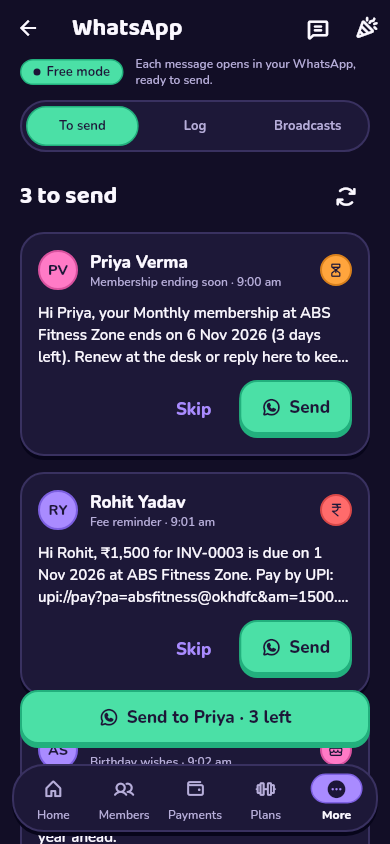 | 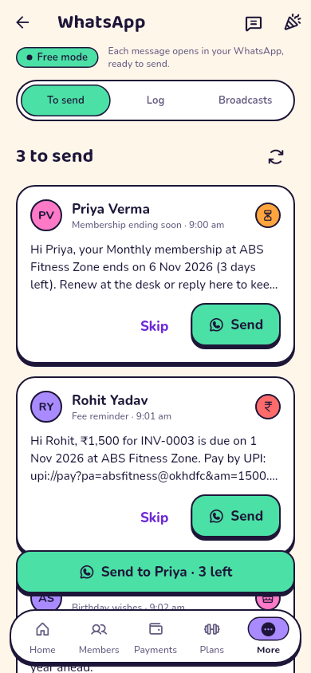 |
| Message log | 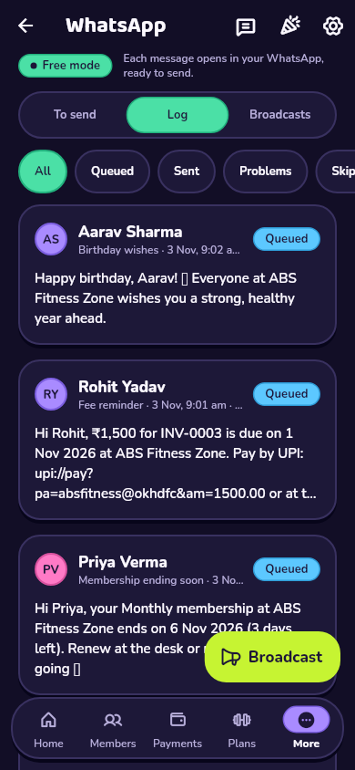 | 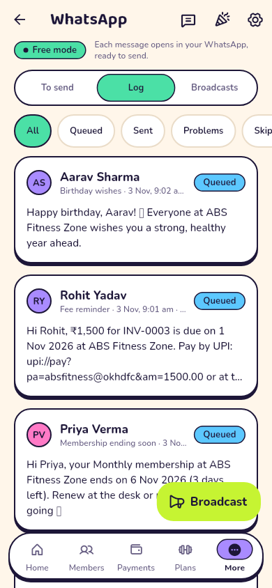 |
| Broadcast composer | 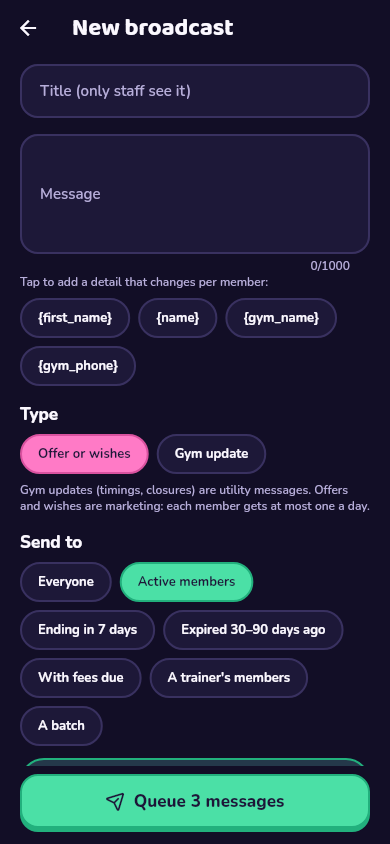 | 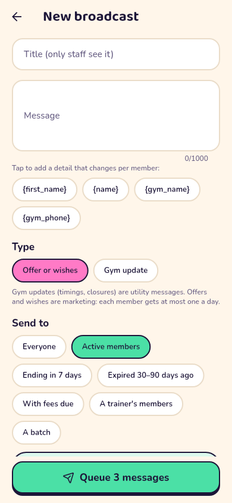 |
| Templates | 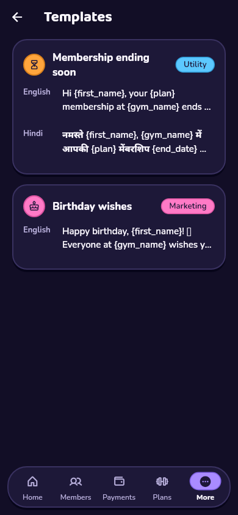 | 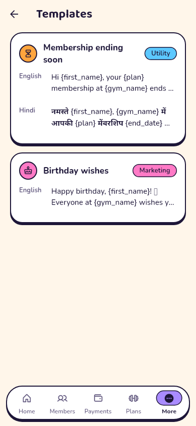 |
| Festival calendar | 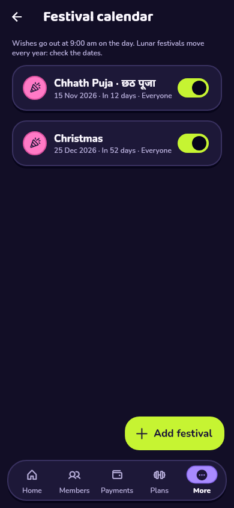 | 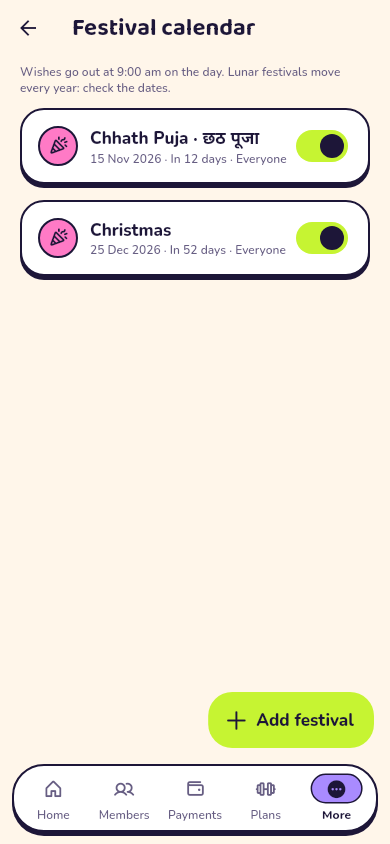 |
| WhatsApp settings | 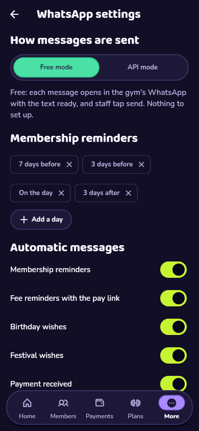 | 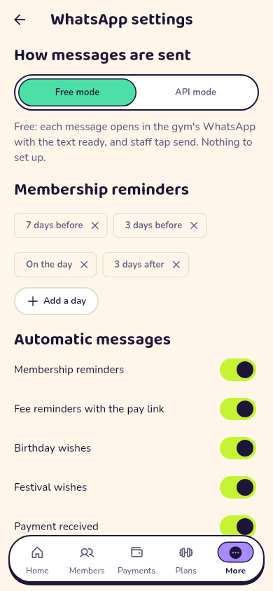 |

These earlier screenshots changed:
- staff home and the tablet shell show the WhatsApp today card;
- More shows the WhatsApp entry;
- the member detail shows the WhatsApp card;
- the member profile shows the WhatsApp switch.

## Acceptance criteria

- **Free mode works with zero setup beyond the gym's WhatsApp number.** The
  migration installs the templates, festivals and the 07:30 job. The queue
  sends with wa.me links from whatever WhatsApp the desk phone has. Widget
  tests run the whole free-mode loop with no API settings.
- **Switching modes needs no code change; only Settings and API credentials
  (stored as Edge Function secrets).**
  - The owner switches in WhatsApp settings (widget test).
  - New messages take the channel of the current mode (database test).
  - The token, phone number ID, app secret and cron secret live only in
    Edge Function secrets (README step 14).
- **No member receives more than 1 marketing message per day or the same
  reminder twice in 24 h.**
  - Every message, automatic or broadcast, goes through `_enqueue`, which
    enforces both. Database tests: "the same reminder never goes twice
    within 24 hours", "one marketing message a day", "birthday beats the
    festival".
  - Messages sent by hand tick the waiting queued one instead of adding a
    second (widget test).
- **Never use unofficial WhatsApp automation libraries.** Free mode opens
  wa.me links for a person to send. API mode calls only Meta's Cloud API
  (`graph.facebook.com`) from an Edge Function.

## Not in M5 (see DECISIONS 120)

- The personalised birthday image card (optional in 8.5).
- The receipt PDF as a link inside the message. The text goes by WhatsApp,
  and the PDF is shared from the app as before.
- Hindi translations of the app's own screens. The Hindi WhatsApp messages
  are done.
- AI-drafted broadcast text (F7, M6).

## Not verified here

- **Real Meta API calls and webhooks:** there are no WhatsApp credentials
  here. The functions are tested with a fake Meta, using the request and
  webhook shapes from Meta's documentation.
- **The scheduled sender:** `pg_net` + `pg_cron` on a real Supabase project
  (README step 14).
- **WhatsApp opening on a phone and the tick on coming back:** the tests
  simulate leaving and returning to the app.
- **An Android build:** CI on `main` builds the APK.
